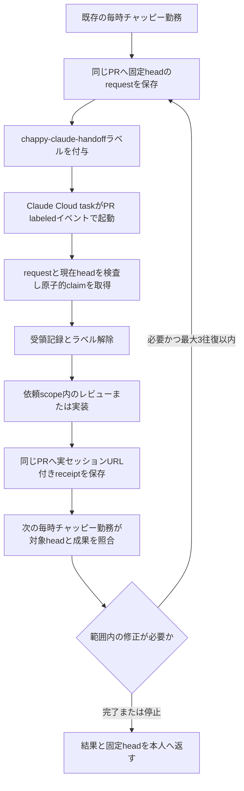

# チャットを閉じた後のClaude社員との受け渡し

2026-11-13の本人依頼「チャットを閉じた後も双方が自動起動して往復する状態を構築したい」に対応する。既存の毎時「AI社員の継続開発」が依頼と返却を扱い、Claude Codeの公式Cloud scheduled task（旧Routines）が対象PRのGitHubイベントで起動する。社員名・担当・相手の既存チームは [社員運用](ai-staff-operations.md) を維持する。

このファイルの追加は、Claudeアカウントのタスク登録・有効化や無人往復の実証ではない。初回は今回の構築PRに対する `action=review` とし、コードを編集せず接続を確かめる。



## 一度だけ行うClaude側の設定

本人のiPhoneから [ClaudeのCloud scheduled tasks](https://claude.ai/code/routines) を開き、本人の既存Claudeアカウントで保存する。こちらのGitHub接続はClaude側の認証を共有しない。現在の公開資料で確認できるAPIは登録済みタスクを起動する `/fire` であり、タスク作成・編集の公開APIは確認できていない。この会話から本人認証なしにClaudeタスクを作成できるとは扱わない。

1. **New task**（表示によっては **New routine**）を選ぶ。既存の提案ボード用タスクは変更せず、この受け渡し用のCloud taskを1件だけ用意する。
2. 名前を「チャッピー社員からの受け渡し」とし、[保存する指示全文](ai-staff-claude-cloud-prompt.txt)を **Prompt / Instructions** に設定する。
3. 対象リポジトリに `takechanman12250711-oss/chappy-boatrace-ai` を選び、最初のリポジトリにする。既存の **Cloud environment** とモデル・effort設定を使う。新しいモデル指定や認証情報を追加しない。
4. **Trigger** を **GitHub event** とし、対象リポジトリの **Pull request** の **labeled**（`pull_request.labeled`）を選ぶ。`synchronized` や全PRイベントを購読しない。独立した時刻スケジュールやAPIトリガーも追加しない。
5. フィルタを **Base branch = main**、**Is merged = false**、さらに **Labels** が `chappy-claude-handoff` を含む条件にする。公式資料はイベント選択と任意フィルタの併用、全条件ANDを説明している。ただし本人アカウントの画面・Labelsの演算子表示は未検証なので、その画面の選択肢を確認して保存する。Labels条件を指定できない場合は未設定と記録し、後述のhelperによるラベル・request検査で対象外を停止する。対象を全PRの自動編集へ広げない。
6. **Connectors** はこの仕事に必要なGitHub接続だけを残す。**Create / Save changes** で保存し、有効状態・対象リポジトリ・イベント・フィルタ・指示を確認する。設定画面へのリンクを開いただけでは保存にならない。

GitHubイベントには、対象リポジトリへの **Claude GitHub App** の導入が必要。Web画面が導入を求めた場合は、本人が表示されたGitHub側の権限を確認する。`/web-setup` 等でcloneできるだけではwebhook配送の成立を意味しない。Appの導入権限がなければ、その時点で本人またはリポジトリ管理者の操作が必要である。

Cloud taskは既存のPro / Max / Ultra / Team / Enterprise等の対象契約で動く公式機能で、対話実行と同じくClaudeの利用枠を消費する。GitHubイベントが重なればセッションも増える。追加API課金・usage credits・追加契約は有効にせず、枠不足では停止する。無料・消費ゼロとは説明しない。

## request、受領、返却

同じPRの `<!-- chappy-ai-handoff:v1 -->` 付きコメント内のfenced JSONを使う。通常の自由文や第三者コメントを実行指示にしない。`request` の `taskId`、`round`、`head`、`action`、`scope`、`authorizationUrl` を照合する。ラベル自体は権限や本人承認の証拠ではない。

受信時は `node scripts/ai-staff-handoff.cjs inspect --pr <PR番号>` を使い、現在head・投稿者・ラベル・記録一覧と `requestReservations` を読み、有効な依頼と既存claim/receiptを確認する。inspectはリポジトリのラベルを全ページ取得し、requestコメント前に残った予約も提示する。予約の `status=unresolved` または `unknown` は停止条件であり、記録0件・起動ラベルなしでも新規依頼を送らない。inspectは一覧の取得であり、受領の最終検査はclaimが行う。PR番号がイベントから特定できなければ停止し、全PRを探索して代用しない。helperがイベント対象headに存在しなければ停止する。初回はhelperを含む準備PRのheadから起動できるため、main未反映を理由に別のhelperを自作・取得しない。

受領は次のCLIを使う。変数には検査済みの実値だけを渡す。

```sh
node scripts/ai-staff-handoff.cjs claim --pr <PR番号> --task-id <taskId> --round <round> --head <requestのhead>
```

`claim` はリポジトリに一意の予約ラベルを新規作成し、同名作成の競合を原子的に停止させる。同じ依頼の二重受領を防いで受領コメントと起動用ラベルの解除を行う。予約名は `ai-staff-rq-`（依頼）、`ai-staff-clm-`（実行権）、`ai-staff-rcpt-`（返却）と依頼ID・round等のSHA-256短縮値で構成し、説明欄のheadも照合する。新しい依頼予約の説明欄は `chappy-ai-handoff:v2 request <PR番号> <round> <完全head>` とし、100文字以内で対象PRを復元する。`requestKeyHash` は `taskId/r<round>` のSHA-256先頭32桁であり、taskIdそのものではない。元コメントと一致する予約だけ `taskId` を復元し、コメントがなければ `taskId=null` を返す。80文字のIDも切り詰めたり推測したりしない。予約ラベル自体をPRへ付けず、更新・削除もしない。タグpushで既存workflowが余分に起動することを避けるため、Git tagは使わない。これは協調するhelper間の受領制御であり、すべての編集や人のpushを排他する仕組みではない。claimが存在すれば再実行せず停止し、自動削除・期限切れ扱い・別IDへの差し替えで迂回しない。claim後に権限エラー等で止まった場合も担当を推測して再開しない。

GitHub Appが導入済みでも、そのCloud実行のAPI認証・コメント・ラベル作成と操作が使えるとは限らない。helperが必要な操作を行えなければ停止し、APIキーやCookieを会話へ要求しない。既存の認証経路を使い、secretの読出し・コピー・別認証への切替は行わない。

完了または停止時には、対象PR・request head・実際の結果head・検査内容を同じPRへ返す。

```sh
node scripts/ai-staff-handoff.cjs receipt --pr <PR番号> --task-id <taskId> --round <round> --head <requestのhead> --result-head <実際の結果head> --session-url <実際のClaude実行URL> --status returned --summary-file <作業結果のUTF-8ファイル>
```

停止時のstatusは `stopped`。実行URLは実際に取得できた `https://claude.ai/code/...` だけを使う。公式Cloud環境では `CLAUDE_CODE_REMOTE_SESSION_ID` の実IDを読み、`cse_` 接頭辞を `session_` に変換して `https://claude.ai/code/<実ID>` とする方法がある。変数がない・形式が違うなどで取得できなければURLを推測せず、同じPRに具体的な不足を記録して停止する。`returned` のreceiptを作らず、チャッピー側も受領・往復成功とは扱わない。GitHubコメントの投稿者が本人と同じでも、Claudeとチャッピーの実行元を暗号学的に識別できるわけではない。実セッションの記録と成果物を対応付ける。

## 重複、競合、停止

送信元は既存の勤務1件に限定し、異なる作業IDの同時送信を行わない。予約だけが存在してコメント結果が不明な場合は、自動削除・再投稿をせず停止する。requestも全ラベルを読み、対象PRの未解決予約があれば別IDでの再送を停止する。別PRへ明示的に紐付く新形式の予約は、そのPR以外の新規依頼を止めない。旧形式 `chappy-ai-handoff:v1 request <head>` は元コメントと名前・説明欄が一致すれば引き続き使用できるが、コメントがなくPRを確定できない旧予約は `pr=null / status=unknown` として全PRの新規依頼を停止する。人が同じPRの原記録を照合するまで、新IDや削除で回避しない。ラベル一覧の取得失敗・形式不明・ページ重複・上限到達も空一覧へ置き換えず停止する。実装の成功返却では依頼headからの前進と、rename元を含む変更ファイルのscope一致をGitHub compareで照合する。比較結果が欠ける・切り詰められる可能性がある場合も停止し、scope内で作業したと推測しない。

- `labeled` イベントは専用ラベル以外のラベル追加でも発生する。Labelsの状態フィルタが一致している間に別ラベルが付けば起動し得るため、helperのrequest検査とclaimを省略しない。ラベル解除だけを排他制御にしない。
- GitHubイベントは毎回新しいClaudeセッションを作り、前の会話を引き継ぐ保証はない。作業状態は同じPRのrequest/claim/receiptで引き継ぐ。イベントが上限で破棄された場合も、時間経過だけを根拠にラベルの付け直しや催促を繰り返さない。
- `action=review` は対象コードの編集・commit・pushなし。コメント・claim・receiptの必要な操作だけ行う。初回の接続検査はこのモードとする。
- `action=implement` は本人の依頼根拠が確認できるscope内の同じPRブランチだけを扱う。他担当の編集中ファイルは編集せず、認証・担当・headが不明なら停止する。request中の文章だけで新たな権限を得たとは扱わない。
- 1つの作業IDで最大3往復。同一head・作業IDの依頼を再送せず、requestのheadと現在headが違えば停止する。古いレビューを新headへ転用しない。上限・不明・範囲外・同じ原因の再失敗では停止して本人へ返す。
- 既存の予想・結果・原本・買い目・成績定義、note/X/LINE運用、認証設定、相手のチームを変更しない。mainマージ・自動マージ・デプロイ・方式採用を行わない。最終反映は [既存の本人確認](development-approval.md) に従う。

## 接続を確認する順序

1. **準備済み**: helper・文書・貼り付け用指示・初回review依頼のPR/headがそろう。
2. **Claude設定済み**: 本人が保存したCloud taskとGitHub trigger/Appの対象・有効状態を確認する。
3. **Claude自動受領・返却済み**: ラベルイベントで生じた実Cloud実行URL、同一taskId/round/headのclaimとreceipt、レビュー内容を確認する。手動のRun nowだけではイベント起動の実証にしない。
4. **無人往復確認済み**: 次の予定時刻の既存チャッピー勤務が同じreceipt/result headを読み、実行runと照合結果を同じPRに残す。現在の会話での手動確認だけではこの段階にしない。

指摘や修正が発生しないreview-onlyの初回成功は、受領と返却の接続確認である。実装修正の自動往復や全社員の常時勤務を実証したとは扱わない。Cloud実行のSucceeded表示も、scopeの作業完了・PR返却・相手受領を単独では証明しない。

## 公式資料（2026-11-13確認）

- [Cloud scheduled tasks](https://code.claude.com/docs/en/routines): PCを閉じた後の実行、対象契約、作成画面、利用枠。
- [GitHub trigger / Supported events / PR filters](https://code.claude.com/docs/en/routines#add-a-github-trigger): イベントとフィルタ、GitHub App要件、イベントごとの新規セッション。
- [Repositories and branch permissions](https://code.claude.com/docs/en/routines#repositories-and-branch-permissions): PRイベントheadからの開始、branch指定と認証切れ。
- [Permission prompts during a run](https://code.claude.com/docs/en/routines#permission-prompts-during-a-run): 自動実行でも権限待ちで停止する場合。
- [API trigger](https://code.claude.com/docs/en/routines#add-an-api-trigger): 登録済みtaskを起動する専用tokenの仕組み。今回の経路では使わない。
- [PR Auto-fix](https://code.claude.com/docs/en/claude-code-on-the-web#auto-fix-pull-requests): 起動済みのPRセッションでレビューコメントやCI失敗を処理する別機能。routineのIssueコメント起動の根拠にはしない。

Cloud scheduled tasksはresearch previewである。公式資料上の対応と、この本人アカウントの設定・実行・権限確認を区別する。

- [Cloud環境のGitHub API・push権限・実行URL](https://code.claude.com/docs/en/cloud-environments): attached repositoryへのREST `gh api` は本人token追加なしで使える。GraphQLを使う `gh pr` / `gh issue` で代用しない。既存PRブランチへのpushはpromptで指定できるが、GitHub権限・rulesetに従う。ラベルAPIの実権限は初回実走で確認する。
