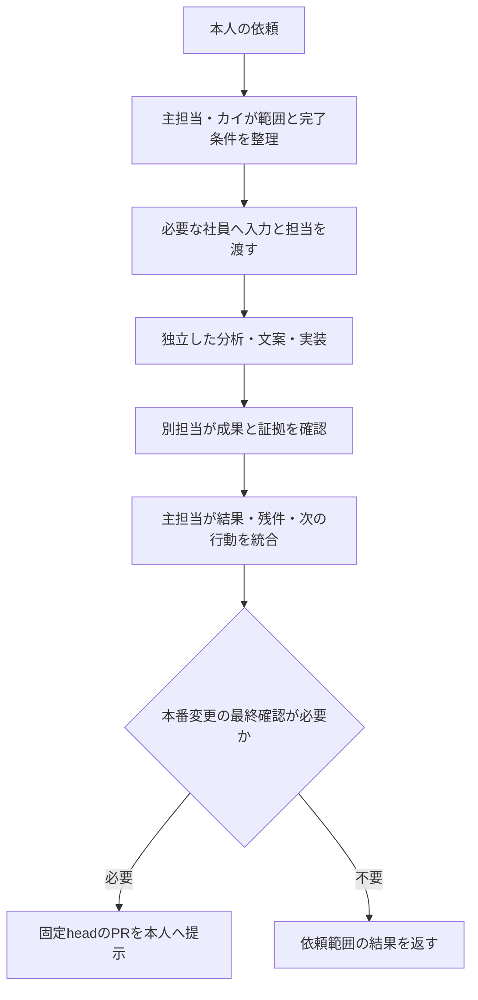

# AI社員の分業運用

社員の名前・役割は `staff.html` の6人とホムラ班4人を引き継ぐ。実行中の会話や、本人が有効にした無人タスクの中で、必要な担当だけへ仕事を委任し、成果を次の担当へ渡す。依頼の整理と進行管理は主担当のAIが受け持ち、ユーザーへ社員ごとの指示の転記を求めない。チャットを閉じた後の実行元と確認方法は [無人勤務の接続](ai-staff-autonomous.md) を使う。

## 社員と担当

| 社員 | 既存の担当 | 主な受け渡し先 |
| --- | --- | --- |
| カイ | チームキャプテン、展開設計・最終判断 | 依頼を分解し、必要な社員と完了条件を決める。成果を統合して本人へ返す |
| ミナト | データ分析・傾向検証 | 保存済み成績の鮮度・母数・比較条件を確認し、検証結果を返す |
| ホムラ | 攻めの展開・プラン設計、発信班の取りまとめ | 保存された展開の根拠を検討し、必要な発信担当へ渡す |
| ルリ | ST・展示・水面解析 | 公式入力の出典・取得時刻・不足を確認し、分析の前提を返す |
| コハク | 買い目構成・安全カバー | 保存原本との一致、買い目の重複・欠落、監査・停止条件を独立に確認する |
| ワカバ | AI・自動化・実績管理、システム・検証 | 依頼範囲の不具合修正・検査・PRを進め、固定headと証拠を返す |
| ソラ | ホムラ班、X投稿の文案 | 検証済み情報からX文案を返す。送信は既存経路の別工程 |
| シズク | ホムラ班、note記事の見せ方 | 保存原稿を変えずに見せ方の改善案を返す |
| ヒナタ | ホムラ班、発信カレンダー | 既存の公開予定・締切から発信順と残件を整理する |
| ツムギ | ホムラ班、改善案の検証 | 保存済みの比較・前向き検証を確認し、採否の根拠を返す |

社員の「最終判断」は作業結果の統合であり、本人のmain反映・予想方式採用の承認を代替しない。

## 依頼から返却まで



1. 最新main、関連PRの最新コメント、現在の依頼を照合する。既存の担当・未完了作業を引き継ぐ。
2. 主担当が1つの作業ID、目的、完了条件、担当ファイル、入力のref・SHA・生成時刻を決める。質問は本当に不足する条件だけにまとめる。
3. 単独で済む依頼は主担当が処理する。独立した仕事がある場合だけ、まず2〜4名程度へ委任する。人数を満たすための分析や、毎回10名の起動は行わない。
4. 同じファイルを編集する担当は1名にする。調査・独立レビューは並行できるが、先行成果が必要な工程は順に進める。
5. 実装担当と独立レビュー担当を分ける。入力やheadが変われば、その変更に必要な検査とレビューを取り直す。
6. 主担当が証拠付きの結果を統合する。担当を付けただけの仕事を実行済みにせず、未実行・未確認・停止理由を残す。

## よく使う分担

| 依頼 | 最初の担当 | 次の工程 |
| --- | --- | --- |
| 進捗・現状確認 | ミナト：保存集計、ワカバ：対象の実行記録 | カイが問題と次の1件を統合 |
| アプリ・自動処理の修正 | ワカバ：原因と実装 | コハク等の別担当が差分・保存条件を確認 |
| 予想改善の検討 | ミナト：比較、ルリ：入力、必要ならホムラ：展開根拠 | ツムギ：前向き検証、コハク：監査。本番採用は別確認 |
| noteの見せ方 | シズク：表示案、コハク：原本との一致 | 必要な実装だけワカバへ |
| 発信の改善 | ホムラが範囲を整理し、ソラ・ヒナタ等へ | ツムギが保存済み指標を確認。投稿は既存の許可条件に従う |

個別レースの予想作成や公開を、チーム運用の設定だけを根拠に始めない。各作業は既存の `chappy-*` スキルと最新の正本に従う。

## 担当間の受け渡し

同じIssueまたはPRへ次を記録する。リポジトリに残す必要がない短い依頼は、主担当の会話内記録でよい。実装や長い作業では、既存の同じPRを正本にし、作業のたびに重複Issueを作らない。

```text
作業ID:
本人の目的・完了条件:
担当社員・編集担当ファイル:
入力: repository / ref / SHA / 対象期間 / 生成・取得時刻
確認した事実と証拠: file / PR / run / artifact / 公開receipt
成果・実施した検査・対象head:
未実行・未確認・停止理由:
次の担当・次の具体的な1件:
```

開始前に、主担当・入力・編集範囲の重複を確認する。返却時に、完了条件に足りない項目を明記する。同じ失敗の無制限な再試行を行わず、引き継ぎ時も既存の停止条件を維持する。

## 実行環境ごとの使い方

- **この会話／Codexの主担当**：共有 `chappy-ai-staff` スキルを読み、実際に利用できるサブエージェントへ役割と対象ファイルを渡す。社員ごとの指示の正本は `.claude/agents/chappy-*.md`。Claude用frontmatterをCodexが自動で登録すると説明せず、主担当が本文を読ませて委任する。サブエージェントが使えない場合は逐次処理と明記する。
- **Claude Code**：プロジェクト用 `.claude/agents/chappy-*.md` を使う。呼出元が必要な社員へ委任する。新しいagentsディレクトリを初めて追加した既存セッションでは、再開後に定義の検出を確認する。ファイルの検証合格、社員の実行、成果返却はそれぞれ確認する。
- **GitHub Actions**：既存の収集・集計・監視・公開処理を継続する。workflowの定期実行は、社員モデルが無人で判断した証拠にはならない。社員は必要なときに、担当する既存処理の保存結果を確認する。

社員定義は常駐プロセスやスケジュールではない。チャットを閉じた後の運用は、本人が対象・頻度・利用枠を確認した1つのタスクを別に登録し、実行元・起動・成果を読み戻して確認する。定義追加、タスク登録、初回の無人実行成功は別々に記録する。会話内の分業も無人実行も利用枠を消費するため、消費ゼロとは説明しない。

Claude CodeとCodexの直接接続・本人認証は別の確認事項。この会話の分業が動くことを、別環境のClaudeのログインや両モデルの連携完了と扱わない。

## 維持する運用条件

- 展開から判断する既存の優先順位、保存予想・公式結果・買い目・方式別の会計を維持する。社員の意見だけで本番の方式や重みを変えない。
- 過去原本の改変、結果に合わせた予想の補作、研究候補の自動採用を行わない。
- 停止済み監視の一括再開、新しいcron、有料AI API、追加契約、自動マージは行わない。無人勤務は本人が頻度と利用枠を確認した1つの実行元だけを使う。既存の許可された自動処理は維持する。
- 公開・配信は、対応する既存スキルと元原稿・締切・予約・receiptの条件を使う。文案の返却を投稿済みと扱わない。
- main反映は `docs/development-approval.md`、Claudeとの受け渡しは `docs/claude-codex-development.md` に従う。社員の役割で権限や本人確認を緩めない。

公式の社員定義形式: https://code.claude.com/docs/en/sub-agents
