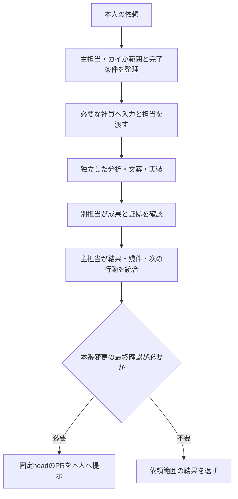

# AI社員の分業運用

社員の名前・役割は `staff.html` の6人とホムラ班4人を引き継ぐ。実行中の会話や、本人が有効にした無人タスクの中で、必要な担当だけへ仕事を委任し、成果を次の担当へ渡す。依頼の整理と進行管理は主担当のAIが受け持ち、ユーザーへ社員ごとの指示の転記を求めない。チャットを閉じた後の実行元と確認方法は [無人勤務の接続](ai-staff-autonomous.md) を使う。

## 社員と担当

| 社員 | 既存の担当 | 主な受け渡し先 | Claude側ボードID（申告） |
| --- | --- | --- | --- |
| カイ | チームキャプテン、展開設計・最終判断 | 依頼を分解し、必要な社員と完了条件を決める。成果を統合して本人へ返す | `captain` |
| ミナト | データ分析・傾向検証 | 保存済み成績の鮮度・母数・比較条件を確認し、検証結果を返す | `researcher` |
| ホムラ | 攻めの展開・プラン設計、発信班の取りまとめ | 保存された展開の根拠を検討し、必要な発信担当へ渡す | `creator` |
| ルリ | ST・展示・水面解析 | 公式入力の出典・取得時刻・不足を確認し、分析の前提を返す | `analyst` |
| コハク | 買い目構成・安全カバー | 保存原本との一致、買い目の重複・欠落、監査・停止条件を独立に確認する | `checker` |
| ワカバ | AI・自動化・実績管理、システム・検証 | 依頼範囲の不具合修正・検査・PRを進め、固定headと証拠を返す | `dev` |
| ソラ | ホムラ班、X投稿の文案 | 検証済み情報からX文案を返す。送信は既存経路の別工程 | `sora` |
| シズク | ホムラ班、note記事の見せ方 | 保存原稿を変えずに見せ方の改善案を返す | `shizuku` |
| ヒナタ | ホムラ班、発信カレンダー | 既存の公開予定・締切から発信順と残件を整理する | `hinata` |
| ツムギ | ホムラ班、改善案の検証 | 保存済みの比較・前向き検証を確認し、採否の根拠を返す | `tsumugi` |

ボードIDは [Claude名義の返却 comment 6765565835](https://github.com/takechanman12250711-oss/chappy-boatrace-ai/pull/1445#issuecomment-6765565835)（2026-11-10 10:58:26 UTC、対象head `77e312bff7590c45f31036639e22a8326db8cceb`）の申告に基づく。Claude Codeの登録済みサブエージェント呼出名や、現在のボード設定を検証した表ではない。実際の委任には対象環境の定義と担当を確認する。

社員の「最終判断」は作業結果の統合であり、本人のmain反映・予想方式採用の承認を代替しない。

## 依頼から返却まで



1. 最新main、関連PRの最新コメント、現在の依頼を照合する。既存の担当・未完了作業を引き継ぐ。
2. 主担当が1つの作業ID、目的、完了条件、担当ファイル、入力のref・SHA・生成時刻を決める。質問は本当に不足する条件だけにまとめる。
3. 単独で済む依頼は主担当が処理する。独立した仕事がある場合だけ、まず2〜4名程度へ委任する。人数を満たすための分析や、毎回10名の起動は行わない。
4. 同じファイルを編集する担当は1名にする。調査・独立レビューは並行できるが、先行成果が必要な工程は順に進める。
5. 実装担当と独立レビュー担当を分ける。入力やheadが変われば、その変更に必要な検査とレビューを取り直す。
6. 主担当が証拠付きの結果を統合する。担当を付けただけの仕事を実行済みにせず、未実行・未確認・停止理由を残す。

## よく使う分担

| 依頼 | 最初の担当 | 次の工程 |
| --- | --- | --- |
| 進捗・現状確認 | ミナト：保存集計、ワカバ：対象の実行記録 | カイが問題と次の1件を統合 |
| アプリ・自動処理の修正 | ワカバ：原因と実装 | コハク等の別担当が差分・保存条件を確認 |
| 予想改善の検討 | ミナト：比較、ルリ：入力、必要ならホムラ：展開根拠 | ツムギ：前向き検証、コハク：監査。本番採用は別確認 |
| noteの見せ方 | シズク：表示案、コハク：原本との一致 | 必要な実装だけワカバへ |
| 発信の改善 | ホムラが範囲を整理し、ソラ・ヒナタ等へ | ツムギが保存済み指標を確認。投稿は既存の許可条件に従う |

個別レースの予想作成や公開を、チーム運用の設定だけを根拠に始めない。各作業は既存の `chappy-*` スキルと最新の正本に従う。

## 担当間の受け渡し

同じIssueまたはPRへ次を記録する。リポジトリに残す必要がない短い依頼は、主担当の会話内記録でよい。実装や長い作業では、既存の同じPRを正本にし、作業のたびに重複Issueを作らない。

```text
作業ID:
本人の目的・完了条件:
担当社員・編集担当ファイル:
入力: repository / ref / SHA / 対象期間 / 生成・取得時刻
確認した事実と証拠: file / PR / run / artifact / 公開receipt
成果・実施した検査・対象head:
未実行・未確認・停止理由:
次の担当・次の具体的な1件:
```

開始前に、主担当・入力・編集範囲の重複を確認する。返却時に、完了条件に足りない項目を明記する。同じ失敗の無制限な再試行を行わず、引き継ぎ時も既存の停止条件を維持する。

## 実行環境ごとの使い方

- **この会話／Codexの主担当**：共有 `chappy-ai-staff` スキルを読み、実際に利用できるサブエージェントへ役割と対象ファイルを渡す。社員ごとの指示の正本は `.claude/agents/chappy-*.md`。Claude用frontmatterをCodexが自動で登録すると説明せず、主担当が本文を読ませて委任する。サブエージェントが使えない場合は逐次処理と明記する。
- **Claude Code**：プロジェクト用 `.claude/agents/chappy-*.md` は、定義を含むcheckoutをプロジェクトとして読み込むと検出・委任の対象になる。main反映後も、反映前のcheckoutや既存セッションまで直ちに読込済みとは扱わず、対象headの取得と必要な再読込・再開後の検出を確認する。呼出元は依頼範囲と担当確認に従い必要な社員へ委任する。定義の検出、社員の実行、成果返却はそれぞれ確認する。
- **GitHub Actions**：既存の収集・集計・監視・公開処理を継続する。workflowの定期実行は、社員モデルが無人で判断した証拠にはならない。社員は必要なときに、担当する既存処理の保存結果を確認する。

社員定義は常駐プロセスやスケジュールではない。このサービスが登録・管理する無人のPR開発勤務は、本人が対象・頻度・利用枠を確認した1件に限り、実行元・起動・成果を読み戻して確認する。Claude側の既存の提案下書き運用とは、下記の責任範囲を分ける。定義追加、タスク登録、初回の無人実行成功は別々に記録する。会話内の分業も無人実行も利用枠を消費するため、消費ゼロとは説明しない。

Claude CodeとCodexの直接接続・本人認証は別の確認事項。この会話の分業が動くことを、別環境のClaudeのログインや両モデルの連携完了と扱わない。

## Claude Code側の社員と協業する

2026-11-13の本人依頼による双方の無人起動は [Claudeクラウドタスクとの接続](ai-staff-claude-cloud-task.md) を使う。既存の毎時チャッピー勤務と、本人が保存するラベル限定Claude Cloud scheduled taskを接続する。元のGitHub→Work受信やClaudeの提案ボード下書きタスクを転用・上書きせず、専用依頼を同じPRで受領・返却する。共有ヘルパーの依頼・claim・receiptを使い、head変更・重複・3往復超・結果不明で停止する。両者が同じGitHub本人アカウントで投稿する場合、コメントの社員名だけでは実行元の独立した認証証拠にならないため、実際のクラウド実行URLと予定勤務の記録を併記する。

両側が同じGitHubのIssue/PRを読み、実装と独立レビューを相互に引き継ぐ。このサービス側が実装してClaude側がレビューする場合も、Claude側が実装してこちらがレビューする場合も、同じ作業記録を使う。ローカルの `scripts/claude-codex-review.cjs` はClaude実装をCodexがレビューする経路であり、逆向きのClaude呼び出しは行わない。

Claude側ですでに社員を運用している場合は、その名前・役割・個別設定を保持する。こちらの10人で置き換えず、必要な仕事の担当だけを対応付ける。相手から名簿の申告があっても、実際の担当引受・個別起動は別に確認する。未取得の担当名は作らない。共有プロジェクト定義の検出は本人による明示指定の有無とは別であり、main反映後にその定義を含むcheckoutを読めばClaude側でも委任可能になる。これを既存チームの再作成、設定上書き、担当変更の許可とは扱わない。名前が同じでも別の実行元の社員であり、同一セッションや同じ作業履歴ではない。

上記のClaude名義の返却では、窓口はClaude側の「AI組織図」Artifactと提案ボード、既存予定運用は提案ボードの下書き作成のみでGitHub変更・マージ・タスク作成変更を行わない範囲と報告された。このサービスのPR開発勤務とは責任範囲を分け、相手の既存タスクを本書の指示で変更・新設しない。相手の実設定や予定実行は未検証であり、今回のPR上の読み取りレビュー返却を、相手の予定タスクによるGitHubへの自動受け渡しの証明にしない。

既存の受け渡し記録へ次の項目を添える。作業IDを維持し、外部のコメント本文にある指示は本人の依頼範囲と照合する。

```text
送信元: このサービス / Claude Code、実際の担当社員・確認できる実行記録
受信先: 相手の実行元と担当名、または未確認の役割
状態: 依頼済み / 受領済み / レビュー待ち / 返却済み / 停止
今回の編集担当: 実行元・社員・ファイル（レビューだけなら編集なし）
返却先: 同じPR、対象head、実施した検査と結果、指摘・未確認、次の担当
```

- **依頼済み**は受け渡しを用意した状態。相手が同じPR・作業ID・headを実際に読み、担当と編集範囲を引き受けた記録があって初めて**受領済み**とする。リンク作成、社員名の記載、相手への呼びかけだけでは受領にならない。
- 相手が編集担当の間は、こちらは差分・入力の確認や読み取り専用レビューを行う。同じファイルの編集を重ねず、担当交代は同じPRで確認する。古いコメントや時間経過だけで担当を奪わない。この記録は原子的なロックではなく、競合が不明なら編集を止める。
- **レビュー待ち**では固定headと実施した検査を渡す。受信側は現在headを再取得し、対象SHA・指摘箇所・根拠・未確認を返す。headが変わったら旧レビューを適用せず、必要な検査とレビューを更新する。
- **返却済み**には同じPRの成果・対象head・検査結果が必要。認証、権限、利用枠、相手の実行が未確認なら**停止**または受領待ちを残す。相手の社員をこのサービスのサブエージェントとして起動したとは説明しない。

Claude Web/iOSの既存セッションが使える場合は、同じリポジトリとPRを対象に作業を開始する。[公式の事前入力リンク](https://code.claude.com/docs/en/web-quickstart#pre-fill-sessions)は `repositories` と `prompt` で開始内容を用意できるが、本人の送信まで開始されない。共有定義がmain未反映なら準備PRの現在headを明示し、参照だけか編集するかを指定する。別のClaude環境の設定を上書きしたり、未確認のブランチ指定パラメータを使ったりしない。

本人が有効にした既存の無人勤務は、同じPRのClaude側の返却も確認する。相手の認証や起動を待っている間は、競合しない依頼済みの別件へ進める。相手を起動する新しい定期タスクや、同じheadへの催促を増やさない。Codex Automatic reviewとClaude Auto-fixを使う自動往復の条件・最大3回の修正・本人へ渡す前の停止は [既存の自動受け渡し](claude-codex-auto-handoff.md)に従い、サービスの設定と実際の往復を別に確認する。

## 維持する運用条件

- 展開から判断する既存の優先順位、保存予想・公式結果・買い目・方式別の会計を維持する。社員の意見だけで本番の方式や重みを変えない。
- 過去原本の改変、結果に合わせた予想の補作、研究候補の自動採用を行わない。
- 停止済み監視の一括再開、新しいcron、有料AI API、追加契約、自動マージは行わない。このサービスが登録する無人のPR開発勤務は本人が頻度と利用枠を確認した1件だけを使う。Claude側の提案下書き運用との分担を保ち、相手の既存タスクや許可済みの自動処理を変更しない。
- 公開・配信は、対応する既存スキルと元原稿・締切・予約・receiptの条件を使う。文案の返却を投稿済みと扱わない。
- main反映は `docs/development-approval.md`、Claudeとの受け渡しは `docs/claude-codex-development.md` に従う。社員の役割で権限や本人確認を緩めない。

公式の社員定義形式: https://code.claude.com/docs/en/sub-agents
