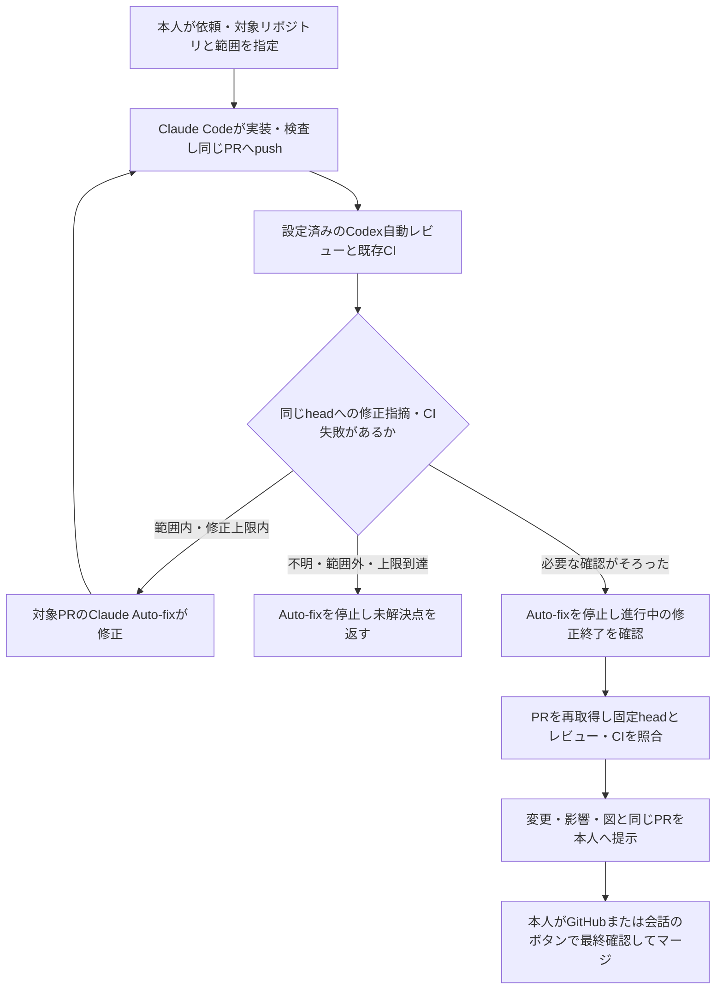

# Claude CodeとCodexの自動受け渡し

Claude Codeの公式PR Auto-fixと、Codexの公式GitHub Automatic reviewを同じPRへ接続する。設定と利用条件がそろったPRでは、レビュー依頼のためのURL転送と、レビュー結果の手動コピーを省ける。新しい仲介サーバー、Actionsからのbotメンション、有料API、cronは追加しない。既存の予想・保存原本・公式結果・note/X運用には触れない。

この文書は共有する作業手順であり、サービスの設定を変更した記録ではない。Codexの対象リポジトリ設定と、Claude側の対象PRのAuto-fixは別々に確認する。既存契約で機能を利用できなければ停止し、追加契約やAPI課金へ切り替えない。Claude Webとこの会話の認証・セッションは共有されない。

## iPhoneで行う設定

| 場所 | 操作と適用範囲 |
| --- | --- |
| Codex（対象リポジトリの設定） | [Code review設定](https://chatgpt.com/settings/code-review)で `takechanman12250711-oss/chappy-boatrace-ai` の接続・利用可能性を確認し、通常のコードレビューの `Automatic review` を有効にする。`Review trigger` は実際の画面の選択肢を確認し、このPRの作成者・作成時・修正後の更新を対象にできる場合は、その設定を選ぶ。更新時のトリガーを確認できなければ、再レビューは未設定・確認待ちとする。Security reviewの設定で代用しない。設定の保存だけで実レビュー完了とはしない。 |
| Claude Code（対象PRごと） | [Claude Code Web](https://claude.ai/code/new)で同じリポジトリの開発セッションとPRを用意する。WebのPRステータスバーから `Auto-fix` を有効にする。モバイルでは同じセッションで「このPRを監視し、CI失敗やレビューコメントを修正して」と依頼できる。対象PRの監視が開始されたことを実際の表示で確認する。 |

Codex側のリポジトリ設定と、Claude側のPRごとの開始操作を区別する。Codexの設定を一度保存したことを、今後の全PRでClaude Auto-fixが開始済みという意味にはしない。本人の通常のアプリ操作で設定し、認証コード・APIキー・Cookieを会話・PR・Gitへ渡さない。PCや開発者ツールによる認証抽出は使わない。

Draft PRのまま自動レビューされるかは、対象リポジトリの実際のトリガー設定と実行結果で確認する。Draft作成だけでレビュー済みとはしない。設定上必要なら、依頼範囲の実装・検査後に同じPRを `Ready for review` にする。これはレビューを開始するための状態変更であり、本人承認やマージではない。自動レビューが進行中なら、同じheadへの手動レビュー要求を重ねない。トリガーが一致しない・未設定の場合は、その状態を報告する。

## PRごとの作業契約

Claude Codeへ次の条件を依頼範囲と一緒に渡す。最大3回はこのプロジェクトの指示上の修正上限であり、サービスが機械的に保証する上限ではない。共有手順を読んだだけで監視が開始したとは扱わない。

> 対象は takechanman12250711-oss/chappy-boatrace-ai の今回の開発PRだけ。作業開始base SHA、PR番号、実装後head SHA、実行した検査と終了コードを記録する。同じPRを使い、CI失敗とCodexの実レビュー結果を確認して、依頼範囲内の修正を最大3回まで行う。原因不明、範囲外、認証失敗、同じ原因の再失敗ではそれより前でも停止する。保存予想・公式結果・note/X運用を変更せず、別のPRや依頼されていない変更へ移らない。各修正後の新headでレビューと必要なCIを確認する。最後はAuto-fixを停止し、進行中の修正が終了したことを確認してからPRを再取得する。現在headに対応するレビュー・CI・変更内容・影響・フローチャート・未確認点を示し、「このPRをGitHubで確認」のリンクを返す。マージ・自動マージは行わず、本人のGitHubでの最終確定操作、または会話のマージ承認ボタンを待つ。

CI失敗は実ログと該当headで原因を確認する。外部障害・権限不足・枠不足を解消するために、検査や採用条件を緩めない。同じ失敗を無制限に再試行しない。修正上限までに確認できなければ、Auto-fix停止と未解決点の返却を行う。

CodexがGitHubへ返した実レビューと、その対象commitを確認する。コメント本文の「Codex」という名前、人の転記、botの受付表示だけを完了証拠にしない。GitHub上の投稿者とレビューの対象commit、結果へのURLを対応付ける。単独コメントで対象commitを確認できない場合は未確認とし、現在headに対するレビューへ推測で読み替えない。CI成功と「指摘なし」は別であり、レビューを待っている状態も明示する。

作業開始時の固定baseと、mainの進行に伴うPR APIのbaseは区別する。headが変わったら以前のレビュー・CIを新headへ転用しない。原本や全期間データをこの連携の確認用に取得・再計算しない。

## 本人承認へ渡す前に止める

本人が承認画面を見ている間にAuto-fixがpushしないよう、対象PRのAuto-fixを停止し、進行中の修正が終了した状態を確認する。公式の停止方法は、`claude.ai/code` の対象セッションのCIステータスバーでAuto-fixのトグルを外すか、Claudeへ「このPRの監視を停止して」と依頼する操作である。停止状態を確認できない場合は、その不確実性を残し、固定headで本人承認できる状態と報告しない。

その後にPRを再取得し、リポジトリ、PR番号、main向けのbase、現在headを確認する。現在headに対応する必要なレビューと既存CIを照合し、[開発変更の最終確認](development-approval.md)の共通資料を更新する。headが変わっていたら、必要な検査・レビュー・提示内容を更新してから渡す。本人も最終確定の直前にGitHub上の現在headを確認する。これは作業手順であり、GitHubのブランチ保護を新しく追加した機械的なロックではない。

AIは本人の承認なしにマージせず、自動マージ・自己Approveを使わない。会話のボタン承認によるマージは `docs/development-approval.md` の条件に従う。既存のrequired checks・required reviews・権限を緩めない。PRを開くボタン、`Ready for review`、CI成功、レビュー完了を本人の最終承認へ読み替えない。本人がマージした後にmain反映を別途確認する。

## 接続確認用PRと実証の範囲

[PR #1343](https://github.com/takechanman12250711-oss/chappy-boatrace-ai/pull/1343) と `[連携確認・マージ不要]` のPRは、この自動修正ループの対象にしない。Auto-fixを開始せず、確認済みのファイル・headを修正しない。Draft・未マージの接続証拠として保持する。

PR #1343で確認できたのは、Claude側の実行結果、Codex側の読み取り専用レビュー、その結果の手動返却による初回連携である。公式サービスを使った無人の受け渡しは別の検証である。

自動連携の初回実証では、通常の開発PRについて次を記録する。設定値、コードの存在、fixtureやCI成功だけで全体を完了扱いにしない。

- PR番号、作業開始base、各段階のhead、レビュー・CIの結果URL。
- 人がURLやレビュー本文を転記せず、設定済みCodexが対象headを実際にレビューした記録。
- Claudeの対象PRのAuto-fixが実際の修正指摘またはCI失敗を受信し、依頼範囲内で修正した新head。修正を要する入力がなければ、修正ループは未確認のままとする。検証のために本番コードやCIを故意に壊さない。
- 修正後headに対する必要なレビュー・CI、Auto-fix停止、本人へ提示するheadの再照合。本人の最終マージは別に記録する。

この手順が接続するのは、GitHub上のレビューとClaudeの対象PRセッションである。CodexのbotレビューをClaudeが実際に受信・処理したかも、上記の初回実証で確認する。このChatGPT会話から新しいClaudeセッションを自動起動したり、この会話へ必ず返信したりする機能を追加したわけではない。ここから着手した開発も、Claude側で対象PRのAuto-fixを開始した証拠が必要であり、開始済みと推測しない。手順追加時点の状態は「リポジトリ側の共有手順を準備済み、本人設定と公式サービスでの実証は未確認」であり、サービス設定・無人実行を確認してから更新する。

公式資料（2026-10-20確認）:

- [Codex GitHub integration](https://developers.openai.com/codex/third-party/github)
- [Claude Code Web: Auto-fix pull requests](https://code.claude.com/docs/en/claude-code-on-the-web#auto-fix-pull-requests)
