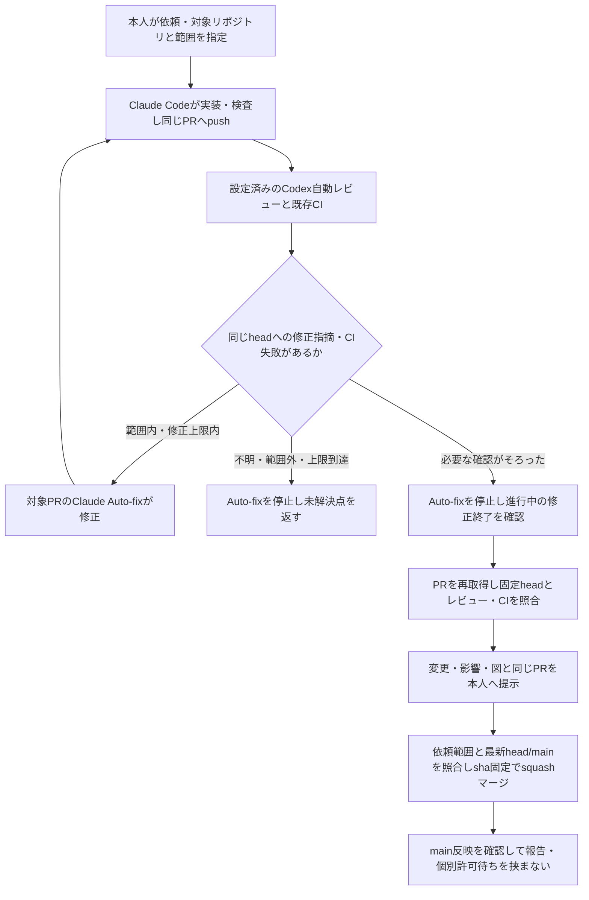

# Claude CodeとCodexの自動受け渡し

2026-11-13の本人依頼による**新しいクラウド実行の起動**は [Claude Cloud scheduled taskとの接続](ai-staff-claude-cloud-task.md) を使う。本書のAuto-fixは起動済みPRセッションの修正経路であり、新しいClaudeセッションの起動元ではない。専用ラベルで起動する社員タスクとの指示・修正担当を重ねない。初回は読み取りレビューを検証し、既存毎時チャッピー勤務への返却まで確認する。

Claude Codeの公式PR Auto-fixと、Codexの公式GitHub Automatic reviewを同じPRへ接続する。設定と利用条件がそろったPRでは、レビュー依頼のためのURL転送と、レビュー結果の手動コピーを省ける。新しい仲介サーバー、Actionsからのbotメンション、有料API、cronは追加しない。既存の予想・保存原本・公式結果・note/X運用には触れない。

この文書は共有する作業手順であり、サービスの設定を変更した記録ではない。Codexの対象リポジトリ設定と、Claude側の対象PRのAuto-fixは別々に確認する。既存契約で機能を利用できなければ停止し、追加契約やAPI課金へ切り替えない。Claude Webとこの会話の認証・セッションは共有されない。

## iPhoneで行う設定

| 場所 | 操作と適用範囲 |
| --- | --- |
| Codex（対象リポジトリの設定） | [Code review設定](https://chatgpt.com/settings/code-review)で `takechanman12250711-oss/chappy-boatrace-ai` の接続・利用可能性を確認し、通常のコードレビューの `Automatic review` を有効にする。`Review trigger` は実際の画面の選択肢を確認し、このPRの作成者・作成時・修正後の更新を対象にできる場合は、その設定を選ぶ。更新時のトリガーを確認できなければ、再レビューは未設定・確認待ちとする。Security reviewの設定で代用しない。設定の保存だけで実レビュー完了とはしない。 |
| Claude Code（対象PRごと） | [Claude Code Web](https://claude.ai/code/new)で同じリポジトリの開発セッションとPRを用意する。WebのPRステータスバーから `Auto-fix` を有効にする。モバイルでは同じセッションで「このPRを監視し、CI失敗やレビューコメントを修正して」と依頼できる。対象PRの監視が開始されたことを実際の表示で確認する。 |

Codex側のリポジトリ設定と、Claude側のPRごとの開始操作を区別する。Codexの設定を一度保存したことを、今後の全PRでClaude Auto-fixが開始済みという意味にはしない。本人の通常のアプリ操作で設定し、認証コード・APIキー・Cookieを会話・PR・Gitへ渡さない。PCや開発者ツールによる認証抽出は使わない。

Draft PRのまま自動レビューされるかは、対象リポジトリの実際のトリガー設定と実行結果で確認する。Draft作成だけでレビュー済みとはしない。設定上必要なら、依頼範囲の実装・検査後に同じPRを `Ready for review` にする。これはレビューを開始するための状態変更であり、本人承認やマージではない。自動レビューが進行中なら、同じheadへの手動レビュー要求を重ねない。トリガーが一致しない・未設定の場合は、その状態を報告する。

## PRごとの作業契約

Claude Codeへ次の条件を依頼範囲と一緒に渡す。最大3回はこのプロジェクトの指示上の修正上限であり、サービスが機械的に保証する上限ではない。共有手順を読んだだけで監視が開始したとは扱わない。

> 対象は takechanman12250711-oss/chappy-boatrace-ai の今回の本人依頼済み開発PRだけ。開始base SHA、PR番号、実装後head SHA、検査と終了コードを記録する。同じPRでCI失敗と実レビューを確認し、依頼範囲の修正を最大3回まで行う。原因不明、範囲外、認証失敗、同じ原因の再失敗では早く停止する。保存原本と依頼範囲を守り、別件へ移らない。各新headで必要な検査・独立レビュー・既存CIを確認する。最後にAuto-fixを停止し、進行中修正の終了後にPRとmainを再取得する。現在headに対応するレビュー・CI・変更・影響・フローチャート・未確認点を残し、「このPRをGitHubで確認」リンクを返す。重複・依存変更があれば更新・再検査し、非重複で依存影響もなければ理由を記録して続行する。本人依頼済み範囲は個別マージ許可待ちを挟まず、sha固定squashマージとmain反映確認・報告まで進める。新しい自動マージbot・workflowは作らず、本人が特定PRの個別確認・保留を指定した場合は従う。

CI失敗は実ログと該当headで原因を確認する。外部障害・権限不足・枠不足を解消するために、検査や採用条件を緩めない。同じ失敗を無制限に再試行しない。修正上限までに確認できなければ、Auto-fix停止と未解決点の返却を行う。

CodexがGitHubへ返した実レビューと、その対象commitを確認する。コメント本文の「Codex」という名前、人の転記、botの受付表示だけを完了証拠にしない。GitHub上の投稿者とレビューの対象commit、結果へのURLを対応付ける。単独コメントで対象commitを確認できない場合は未確認とし、現在headに対するレビューへ推測で読み替えない。CI成功と「指摘なし」は別であり、レビューを待っている状態も明示する。

作業開始時の固定baseと、mainの進行に伴うPR APIのbaseは区別する。headが変わったら以前のレビュー・CIを新headへ転用しない。原本や全期間データをこの連携の確認用に取得・再計算しない。

## マージ前にAuto-fixを止めてheadを照合する

検証済みheadの照合中にAuto-fixがpushしないよう、対象PRのAuto-fixを停止し、進行中修正の終了を確認する。公式の停止方法は、対象セッションのCIステータスバーでAuto-fixのトグルを外すか、Claudeへ「このPRの監視を停止して」と依頼する操作である。停止状態が不明ならその不足を残し、固定headの反映準備完了と報告しない。

その後にPRとmainを再取得し、リポジトリ、PR番号、main向けbase、現在headを確認する。現在headに対応する独立レビューと既存CIを照合し、[開発変更の検証とmain反映](development-approval.md)の共通資料を更新する。headや関連差分が変われば必要な検査・レビュー・CIをやり直す。無関係の非重複変更は依存影響を確認して理由を記録し続行できる。これは作業手順であり、GitHubのbranch protectionを追加・緩和するものではない。

2026-11-19の本人指示に従い、依頼済み開発は検証・レビュー・CI成功と最新head/main照合後、個別許可待ちを挟まずsha固定でsquashマージする。本人が特定PRの個別確認・保留を希望した場合だけ待つ。自己Approveやrequired checks・required reviews・権限の緩和は行わない。リンクのクリック・Ready for review・レビュー完了を依頼範囲の拡張許可と扱わない。研究から本番採用は別変更として採用gate・封印条件・検証を守り、依頼済みの採用を再承認待ちに戻さない。新課金・実購入・履歴削除など未依頼の別行為へ権限を広げず、マージ後はmain反映を別に確認する。

## 接続確認用PRと実証の範囲

[PR #1343](https://github.com/takechanman12250711-oss/chappy-boatrace-ai/pull/1343) と `[連携確認・マージ不要]` のPRは、この自動修正ループの対象にしない。Auto-fixを開始せず、確認済みのファイル・headを修正しない。Draft・未マージの接続証拠として保持する。

PR #1343で確認できたのは、Claude側の実行結果、Codex側の読み取り専用レビュー、その結果の手動返却による初回連携である。公式サービスを使った無人の受け渡しは別の検証である。

自動連携の初回実証では、通常の開発PRについて次を記録する。設定値、コードの存在、fixtureやCI成功だけで全体を完了扱いにしない。

- PR番号、作業開始base、各段階のhead、レビュー・CIの結果URL。
- 人がURLやレビュー本文を転記せず、設定済みCodexが対象headを実際にレビューした記録。
- Claudeの対象PRのAuto-fixが実際の修正指摘またはCI失敗を受信し、依頼範囲内で修正した新head。修正を要する入力がなければ、修正ループは未確認のままとする。検証のために本番コードやCIを故意に壊さない。
- 修正後headに対応するレビュー・CI、Auto-fix停止、マージ前の最新head/main照合と、その後のmain反映記録。

この手順が接続するのは、GitHub上のレビューとClaudeの対象PRセッションである。CodexのbotレビューをClaudeが実際に受信・処理したかも、上記の初回実証で確認する。このChatGPT会話から新しいClaudeセッションを自動起動したり、この会話へ必ず返信したりする機能を追加したわけではない。ここから着手した開発も、Claude側で対象PRのAuto-fixを開始した証拠が必要であり、開始済みと推測しない。手順追加時点の状態は「リポジトリ側の共有手順を準備済み、本人設定と公式サービスでの実証は未確認」であり、サービス設定・無人実行を確認してから更新する。

公式資料（2026-10-20確認）:

- [Codex GitHub integration](https://developers.openai.com/codex/third-party/github)
- [Claude Code Web: Auto-fix pull requests](https://code.claude.com/docs/en/claude-code-on-the-web#auto-fix-pull-requests)
