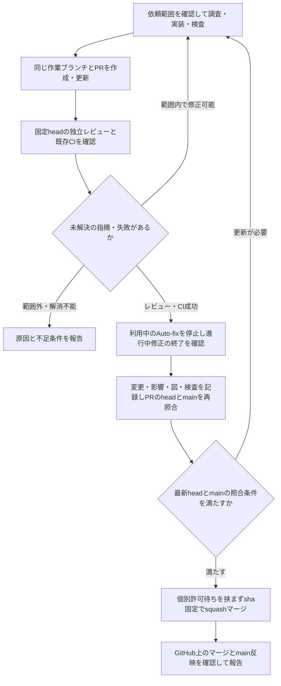

# 開発変更の検証とmain反映

2026-11-19、本人が「パソコンと連携させてるんだから俺の許可待ちで作業止めないで」と指示した。本人依頼済み範囲の実装・修正・研究・検証・main反映は、個別マージ承認を再度求めず完了まで進める。2026-10-20/21の個別確認を必須にした手順を本書で更新し、この方針を整備するPRにも適用する。本人が特定PRの個別確認・保留を明示した場合は、その指示を優先する。

## 依頼済み開発の反映手順

1. 本人の依頼範囲、対象リポジトリ、同じPR、作業開始時のbase SHA、実装後のhead SHAを記録する。自動更新されたmainを開始時baseへ読み替えない。
2. 必要な検証と独立レビューを行い、現在headのCIがすべて完了・成功し、未解決の指摘がないことを確認する。同じheadの古いrunが取り消されていても、対応する新しいrunが成功したことを確認して記録する。失敗・未実施・未確認を成功へ読み替えない。Codexを実行できない場合はその事実を示し、利用可能な独立レビュー経路で確認する。必要なレビュー自体が未完了なら、完了扱いでマージしない。
3. ClaudeのPR Auto-fixを利用した場合は停止し、進行中の修正・pushの終了を確認する。停止・終了を確認できなければその不足を報告する。人の転記やbotの受付表示だけでレビュー完了と扱わない。
4. 変更内容・影響・フローチャート・検証結果・未確認点を共通資料に残し、PRとmainを直前に再取得する。リポジトリ・PR番号・main向けbase・現在headが対象と一致し、レビュー・CIもそのheadに対応することを確かめる。
5. mainが照合時のSHAから進んでいれば、変更ファイルと依存への影響を確認する。PRと非重複で依存への影響もない変更は、確認した理由を記録して続行できる。重複や依存する変更があれば最新mainを取り込み、新headで必要な検査・レビュー・CIを行う。headが変わった場合も同様に再照合し、既に依頼された範囲を個別の再承認待ちへ戻さない。
6. GitHub上の権限・required reviews・required checks・マージ可能状態を確認し、必要ならDraftを解除する。条件を満たした固定headを `sha` に指定し、REST API `PUT /repos/{owner}/{repo}/pulls/{n}/merge` のsquashで個別にマージする。head不一致などで拒否されたら更新・再検査から戻り、確認を省略して再実行しない。
7. GitHub上のマージ状態、マージcommit、mainへの反映を読み戻して報告する。PR作成・CI成功・マージ・サイト公開・実運用の確認を区別する。サイト公開を伴う場合は既存のデプロイ結果も別に確認する。

自己Approveを手順に含めず、required checks・required reviews・権限を緩めない。CI成功、レビューの `completed`、`Ready for review`、PRリンクのクリックは本人依頼の範囲を拡張する許可ではない。独立レビューのreceiptは確認事実であり、レビュー自体が新しい行為を許可するものではない。

## 共通資料と任意の確認導線

この会話、Claude Code、管理画面では同じPRと共通資料を使う。場所ごとに別の承認記録を作らず、全環境でモデルを起動したり表示を確認したりする必須工程を追加しない。Claude Codeへ手順を共有したことと、その環境で実行・受領を確認したことを区別する。

| 場所 | 表示と操作 |
| --- | --- |
| この会話 | 変更・影響・フローチャート・検証状況と、同じ対象PRへの「このPRをGitHubで確認」リンクを示す。反映後はマージ状態とmainを報告する。 |
| Claude Code | 同じPR番号・作業開始base・固定head・検査・残件を返す。Web/iOSなど別環境でもGitHub PRで受け渡す。 |
| 管理画面 | 「成績」→「設定・開発確認」の既存の読み取り導線を任意で使う。画面からの承認やマージ機能を追加しない。 |

表示には対象リポジトリ・PR番号・base/head SHA・変更内容・影響・実施した検査・レビュー状況・未確認点を含める。PR未作成ならその状態を示し、別のPRや最新PRへ自動で差し替えない。未反映の機能を本番確認済みと説明しない。

管理画面への共有URLは `?developmentPr=<PR番号>&developmentHead=<確認済み40桁SHA>#resultSection` とする。実在する対象PRと確認済みheadだけを使う。共有URLを開くだけではGitHubへ通信せず、本人が「対象PRを照合」を押した場合だけ指定PRを読み取る。リポジトリ・main向けbase・固定headの一致後に「このPRをGitHubで確認」を有効にし、不足・不一致・取得失敗では無効にする。これらの表示・クリックは個別マージ許可の必須ゲートではなく、端末内のクリック履歴やチェック状態を承認記録として扱わない。

## 本人が個別確認を希望した場合

本人が特定PRで「マージ前に確認したい」「保留」と指定した場合だけ、そのPRの確認を待つ。通常の依頼済み作業に毎回この質問を追加しない。本人が自分でGitHubの `Merge pull request` / `Confirm merge` 等を操作する方法と、利用可能なら会話の選択質問ボタンで「マージする」「保留」を選ぶ方法を任意で使える。ネイティブ画面へ独自承認ボタンを設置したとは説明しない。

個別確認時はPR番号・タイトル・固定head・照合時main・レビュー・CI・影響・未確認点を示す。保留や無回答をその個別確認への同意と扱わない。本人が確認したheadから変更があれば、必要な再検査と更新内容の再提示を行う。個別確認を指定していないPRは、選択質問ボタンが使えない環境でも前節の反映手順を進める。従来のボタンの有無を作業停止の理由にしない。

## 既存の運用との境界

この方針は本人依頼済みの開発とそのmain反映に適用する。新しい課金API・追加契約・実購入・履歴削除、依頼されていない公開や運用変更などの別行為へ許可を広げない。認証コード・トークン・Cookieを会話・PR・Gitへ渡さない。

研究PRのmain反映と、予想方式・重み・本番選定への採用は別の変更として扱う。原本・会計・締切前契約・未使用期間・研究封印・採用gateを守り、研究結果だけで本番を切り替えない。採用まで既に本人が依頼している場合は、その範囲で必要な検証と採用条件を満たして進め、同じ許可を再度求めて止めない。採用条件を満たしていない状態を、本人依頼だけで合格へ読み替えない。

既に承認されたデータ更新・収集・note/X投稿などの自動処理と、それぞれの実行条件は維持する。新しい自動マージbot・workflow・定期監視を追加せず、既存の `.github/workflows/chappy-apply.yml` の特殊Issue経由の処理を流用しない。現在の作業を担当するAIが、上の照合後に既存の正規経路で個別マージする。

`docs/claude-codex-first-check.md` の `[連携確認・マージ不要]` PRは接続証拠としてDraft・未マージを維持する。この方針はGitHubのbranch protectionを新設・緩和するものではない。
