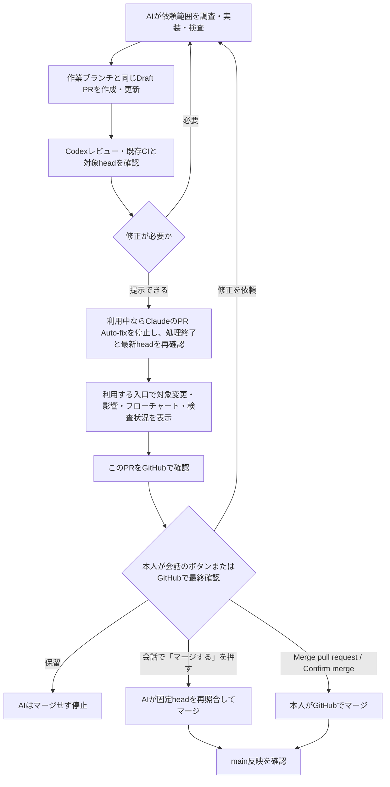

# 開発変更の最終確認

依頼された開発は、AIが調査・実装・fixture検査・レビュー・既存CI・PR作成まで進める。main反映の前に対象変更・影響・フローチャートを示し、本人が会話のマージ承認ボタン、またはGitHubで最終確認してマージする。計画ごとの承認待ちは増やさない。本手順を導入する最初のPRも、実装と検証を済ませてから本人のマージを待つ。

## 3箇所の共通表示

この会話、Claude Code、管理画面のいずれの入口でも、共通資料と同じ対象PRを案内する。場所ごとに別の承認記録を作らず、すべての環境で新しくモデルを起動したり表示確認したりする必須工程にはしない。Claude Codeには次回の作業で使う共有手順として渡し、今回実際に同環境を起動したかとは区別して報告する。

| 場所 | 表示と操作 |
| --- | --- |
| この会話 | 変更内容・影響・フローチャートを示し、対象PRへの「このPRをGitHubで確認」リンクを添える。 |
| Claude Code | 作業結果にも同じ内容とPRリンクを含める。Web/iOSなど別環境でもGitHub PRで引き渡す。 |
| 管理画面 | 「成績」→「設定・開発確認」の折り畳みに、変更内容・影響・フローチャートと、読み取り確認した対象PRへの同名ボタンを置く。 |

会話とClaude Codeでは図と共通PRリンクを使い、ネイティブ画面へ独自承認ボタンを設置したとは説明しない。会話の選択質問ボタンは、次節「会話のボタンでマージを承認する」の条件をすべて満たす場合だけ、本人のマージ承認として使える。

本手順を追加する初回は、管理画面の実装・検証用表示と、main反映後の本番画面・iPhone本人操作の確認を区別して報告する。未反映の機能を本番確認済みと説明しない。

表示には対象リポジトリ・PR番号・base/head SHA・変更内容・影響・実施した検査・レビュー状況・未確認点を含める。未実施・失敗・未確認はそのまま示し、CI成功やレビュー済みへ読み替えない。PR未作成の場合はその状態を示し、別のPRや最新PRへ自動で差し替えない。

管理画面への共有URLは、現在のアプリURLを基準に `?developmentPr=<PR番号>&developmentHead=<40桁の16進SHA>#resultSection` の形式にする。実在する対象PRと確認済みの固定headだけを使い、未登録PRや未確認SHAのURLを作らない。共有URLで「成績」へ移動して「設定・開発確認」を開くが、この時点ではGitHubへ通信しない。

本人が「対象PRを照合」を押したときだけGitHubから指定PRの情報を読み取り、対象リポジトリ・PR番号・main向けのbase・固定headを照合した後に「このPRをGitHubで確認」を有効にする。入力不足・取得失敗・不一致では導線を無効にする。headが変わったら必要なレビュー・CIをやり直し、同じPRの固定head・本文・提示内容を更新して再確認する。GitHubでマージする直前にも、表示・レビュー・CIのheadと現在のheadの一致を本人が確認する。端末内のクリック履歴やチェック状態を承認記録として採用しない。

## GitHubで本人が最終操作する

「このPRをGitHubで確認」はPRを開く導線であり、クリックだけで承認やマージを実行しない。iPhoneからGitHubの本人アカウントで変更内容・現在のhead・検査結果を確認し、GitHubで許可されたマージ方法と権限に従って最終確定操作を行う。ボタン名は `Merge pull request` / `Confirm merge`、設定によっては `Squash and merge` / `Confirm squash and merge` などになるため、実際の表示に従う。

自分が作成したPRは本人でも `Approve` できないため、自己Approveを手順に含めない。既存のrequired reviewsが必要なら、権限を持つ別のレビュアーの確認が必要である。required checks・レビュー要件・権限を満たさずマージできない場合は、その条件を緩めない。PRを開ける状態と、マージ可能な状態は別である。

AIは本人の最終承認待ちで停止し、本人の承認なしにマージ・自動マージを行わない。`completed`、CI成功、`Ready for review`、PRリンクのクリック、端末内の承認記録は本人の最終承認ではない。本人がマージした後、またはボタン承認でAIがマージした後に、GitHub上のマージ状態とmainへの反映を確認し、PR提示と本番反映を区別して報告する。

## 会話のボタンでマージを承認する

2026-10-21 本人承認。GitHubを開かずに、会話の選択質問ボタンでマージを承認できる。GitHubでの本人マージも引き続き使える。

1. 次がそろってから、ボタンを出す。
   - 現在headのすべてのCIが完了・成功している
   - 現在headのCodexレビューが完了し、未解決の指摘がない。Codexを実行できない場合は、未実施であることをボタンの質問文に明記する
   - Auto-fixを使った場合は停止と終了を確認済み
2. ボタンの質問文に、PR番号・タイトル・固定head（短縮SHA）・CI結果・レビュー結果・本番予想や買い目への影響の有無を示す。選択肢は「マージする」「保留」とする。
3. 本人が「マージする」を押した場合だけ、AIは直前にPRを再取得し、headが質問文の固定headと一致することを確認する。一致すればDraftを解除し、`sha` を固定したREST API（`PUT /pulls/{n}/merge`、squash）でマージする。不一致・CI未完了・指摘ありなら、マージせずに再提示する。
4. マージ後にmainへの反映を確認して報告する。
5. 「保留」や無回答ではマージしない。ボタン承認は、そのPR・その固定headに限って有効で、次のPRや新しいheadへ転用しない。
6. 予想方式・重みの本番採用、有料機能、公開操作などの別承認は、このボタンで代替しない。必要な場合は質問文で別承認であることを示し、別に確認する。
7. 自己Approve、required checks・required reviews・権限の緩和、ボタンなしの自動マージは行わない。

Claude CodeのPR Auto-fixを使った場合は、本人の最終確認へ渡す前に、そのPRのAuto-fixを停止し、実行中の修正・pushが終了したことを確認する。その後にPRを再取得し、現在のheadに対応するレビュー・CIと表示内容を照合する。停止・終了を確認できなければ「自動修正停止未確認」として伝え、最終確認の準備完了へ進めない。停止後に追加のpushがあった場合も、旧headの確認を使わず、新headのレビュー・CIを確認し直す。設定と受け渡しは [Claude CodeとCodexの自動受け渡し](claude-codex-auto-handoff.md) を参照する。

## 既存の運用との境界

本手順はAIが準備する開発PRの最終反映に適用する。依頼範囲で行える調査・修正・検査・レビュー・CI・PR作成を、段階ごとの新しい承認待ちで止めない。予想方式の採用・有料機能・公開操作などに必要な既存の別承認は代替しない。

`docs/claude-codex-first-check.md` の `[連携確認・マージ不要]` PRは、接続確認の証拠として扱う従来の手順を維持し、mainへ反映しない。開発変更を反映する今回の機能追加PRとは区別する。

既に承認されたデータ更新・収集・note/X投稿などの自動処理を変更・停止せず、その既存の承認や実行条件も変更しない。新しいAPI・定期監視・自動マージを追加しない（会話のボタン承認による個別マージは自動マージではない）。本人確認のために認証情報を会話・PR・Gitへ引き渡さない。

既存の `.github/workflows/chappy-apply.yml` の特殊Issue経由の自動マージは本件では変更せず、新しい承認手順へ流用しない。今回のPRを自動マージする仕組みは追加せず、管理画面から同workflowを起動しない。

これはAIの作業範囲と本人の操作を定める手順であり、GitHubのbranch protectionを新規設定したり、会話の表示だけでGitHub側の強制機能を追加したりするものではない。
