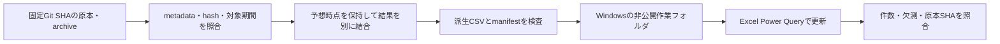

# Windows Excel分析台帳の入力契約（P0調査）

[Issue #1503](https://github.com/takechanman12250711-oss/chappy-boatrace-ai/issues/1503) の本人依頼と、同Issueの[優先順位](https://github.com/takechanman12250711-oss/chappy-boatrace-ai/issues/1503#issuecomment-7056621365)・[Windows共通管理方針](https://github.com/takechanman12250711-oss/chappy-boatrace-ai/issues/1503#issuecomment-7056678270)に対応する。作業IDは `staff-20261121T125937Z-excel-data-contract`。

調査の固定入力は [main `e31a5a3f1198b00bfe85e1ebd51074173065e7ab`](https://github.com/takechanman12250711-oss/chappy-boatrace-ai/tree/e31a5a3f1198b00bfe85e1ebd51074173065e7ab)（commit生成 2026-11-21 12:59:19 UTC / 21:59:19 JST）。以下の出典ファイルリンクはこのcommitに固定し、数・保存時刻も同commit時点の記録を指す。更新中のmainや当日の全開催の現在値へ読み替えない。

今回は、既存データの配置と欠測検査のギャップを確認し、次工程のCSV契約と取込手順を定義した。CSVエクスポータ・Excelブック・更新接続は未実装。Windowsのclone、保存先、Excelの版、Power Query、実機更新は未確認であり、PCへ書込み・追加契約・常駐エージェントの導入を行っていない。

## 先に確定した境界

- 原本とクラウド処理は既存GitHub/APIを正本とする。CSVとExcelは読み取り専用の派生物。予想・買い目・過去結果・会計・価格・公開・認証・研究採用gateを変えない。
- 日次予想の直下JSONだけを完全原本とみなせない。圧縮archiveとmetadataを照合してから読む。indexや画面の件数にも保持上限がある。
- 日次健康チェックの成功は、全レース・全列・展示・公式払戻の整合成功を意味しない。既存結果照合の対象にならない欠測を、CSVへ0や外れとして落とさない。
- Excelでのレース母数と券数、中心・追加・参考、方式世代、モデル収支と実購入損益を分ける。研究保存と本番採用を分け、封印済み研究を再開しない。

上図のCSV以降は次工程の設計であり、接続済み・自動更新済みの記録ではない。

## 実保存先・形式・周期・保持

| 対象 | 保存先と実装 | 形式・時刻と役割 | 既存周期・保持上の制約 |
| --- | --- | --- | --- |
| 日次予想 | [`data/predictions/`](https://github.com/takechanman12250711-oss/chappy-boatrace-ai/tree/e31a5a3f1198b00bfe85e1ebd51074173065e7ab/data/predictions/)、[`collect-predictions.js`](https://github.com/takechanman12250711-oss/chappy-boatrace-ai/blob/e31a5a3f1198b00bfe85e1ebd51074173065e7ab/scripts/collect-predictions.js) | 日付JSONの `runs` / `predictions` / `verificationPredictions` / `shadowV2Predictions`。`raceKey`、`selectedAt` / `capturedAt`、`deadlineAt`、予想方式と `preRaceConditions` を保持 | [`collect-predictions.yml`](https://github.com/takechanman12250711-oss/chappy-boatrace-ai/blob/e31a5a3f1198b00bfe85e1ebd51074173065e7ab/.github/workflows/collect-predictions.yml)：JST06:45、07:00〜22:45の15分間隔。予定周期と実際の保存成功は別。run履歴は日次最大100、runKey置換、primary/verificationはraceKey更新であり、全取得時点の永久保存を保証しない |
| 大きい予想原本 | `data/predictions/source-archives/YYYYMMDD.json.gz` と同 `.meta.json`、[`daily-prediction-source-archive.js`](https://github.com/takechanman12250711-oss/chappy-boatrace-ai/blob/e31a5a3f1198b00bfe85e1ebd51074173065e7ab/scripts/daily-prediction-source-archive.js) | metadataの `sourceUpdatedAt` / `generatedAt` / `sourceBytes` / `archiveBytes` / 両SHA256。既存 `readPredictionSourceArchive` が構成・圧縮bytes/hash・展開bytes/hashを検査する | archive/meta片方だけなら停止。両方なしと片方欠損を区別。復元は一時領域に限定し、Git原本を書き換えない。既存raw保存上限とGit blob上限に対応した保存であり、独立バックアップではない |
| 表示用予想index | [`index-manifest.json`](https://github.com/takechanman12250711-oss/chappy-boatrace-ai/blob/e31a5a3f1198b00bfe85e1ebd51074173065e7ab/data/predictions/index-manifest.json)、`index-shards/`、[`build-prediction-index.js`](https://github.com/takechanman12250711-oss/chappy-boatrace-ai/blob/e31a5a3f1198b00bfe85e1ebd51074173065e7ab/scripts/build-prediction-index.js) | manifest `generatedAt`、`sourceRecordCounts`、隔離数、保持上限。表示用の圧縮・隔離後データ | run100 / primary100 / verification300 / shadow600の保持上限。index件数は日次原本の全件数でもunique race数でもない |
| 公式結果 | `data/results/YYYYMMDD.json`、[`collect-results.js`](https://github.com/takechanman12250711-oss/chappy-boatrace-ai/blob/e31a5a3f1198b00bfe85e1ebd51074173065e7ab/scripts/collect-results.js)、[`api/result.js`](https://github.com/takechanman12250711-oss/chappy-boatrace-ai/blob/e31a5a3f1198b00bfe85e1ebd51074173065e7ab/api/result.js) | 日付、`collectedAt`、`venues`、`races`。各行 `date/jcd/raceNo/source/resultUrl/checkedAt/resultAvailable/status`、3連単・払戻・着順・ST等。失敗行と未確定・不成立を保持 | [`collect-results.yml`](https://github.com/takechanman12250711-oss/chappy-boatrace-ai/blob/e31a5a3f1198b00bfe85e1ebd51074173065e7ab/.github/workflows/collect-results.yml)：JST23:30 / 00:15。既存の最新結果保持merge・source checkpointを使用。受渡しartifactは3日。Gitにある期間と保持保証・復元試験は別 |
| 展示の別保存 | `data/site/before/YYYYMMDD.json`、[`collect-before.cjs`](https://github.com/takechanman12250711-oss/chappy-boatrace-ai/blob/e31a5a3f1198b00bfe85e1ebd51074173065e7ab/scripts/data-site/collect-before.cjs) | `schemaVersion=1` / `kind=boat-data-before`、日付、`generatedAt`、`races`。行の `savedAt`、艇ごとの展示・展示進入ST・水面等。詳細は下記 | [`build-boat-data-before.yml`](https://github.com/takechanman12250711-oss/chappy-boatrace-ai/blob/e31a5a3f1198b00bfe85e1ebd51074173065e7ab/.github/workflows/build-boat-data-before.yml)：JST09:00〜21:40の20分間隔。50分の窓、締切余裕60秒、完全な展示を保存すると再取得停止。全開催・全R取得の保証ではない。当該経路に期間削除は見当たらないが永久保持・独立backupを保証しない |
| 出走表等の別保存 | `data/site/days/YYYYMMDD.json`、[`collect-day.cjs`](https://github.com/takechanman12250711-oss/chappy-boatrace-ai/blob/e31a5a3f1198b00bfe85e1ebd51074173065e7ab/scripts/data-site/collect-day.cjs) | 日付別の開催・R・艇と平均ST等。`savedAt` は収集開始の一括値で個別HTTP取得完了時刻ではない | [`build-boat-data-site.yml`](https://github.com/takechanman12250711-oss/chappy-boatrace-ai/blob/e31a5a3f1198b00bfe85e1ebd51074173065e7ab/.github/workflows/build-boat-data-site.yml)：JST08:23 / 11:43。当日の後刻保存を締切前予想入力として使わない。展示別保存とは別の粒度・被覆範囲 |
| 連続成績 | [`continuous-performance-ledger.json`](https://github.com/takechanman12250711-oss/chappy-boatrace-ai/blob/e31a5a3f1198b00bfe85e1ebd51074173065e7ab/data/stats/continuous-performance-ledger.json)、[`build-continuous-performance-ledger.cjs`](https://github.com/takechanman12250711-oss/chappy-boatrace-ai/blob/e31a5a3f1198b00bfe85e1ebd51074173065e7ab/scripts/build-continuous-performance-ledger.cjs) | `generatedAt` / `diagnostics` / `policy` / `rows`。締切前原本と公式結果を結合し、保存中心券1〜10点を1点100円のモデルで集計。方式世代別あり | 既存結果処理で生成する派生集計。原本・全未確定・全券区分の代わりにはならない。行には原本blobや公式URLがないので原本joinが必要 |
| 研究・週次 | [`race-insight-report.json`](https://github.com/takechanman12250711-oss/chappy-boatrace-ai/blob/e31a5a3f1198b00bfe85e1ebd51074173065e7ab/data/stats/race-insight-report.json)、既存 `data/stats/*`、[`weekly-stats.cjs`](https://github.com/takechanman12250711-oss/chappy-boatrace-ai/blob/e31a5a3f1198b00bfe85e1ebd51074173065e7ab/scripts/weekly-stats.cjs)、[Issue #1442](https://github.com/takechanman12250711-oss/chappy-boatrace-ai/issues/1442) | 方式・対象期間・母数・除外・`generatedAt`・採用可否を持つ既存保存結果を読む。研究値は `usableForPrediction=false` 等を維持 | [`weekly-stats.yml`](https://github.com/takechanman12250711-oss/chappy-boatrace-ai/blob/e31a5a3f1198b00bfe85e1ebd51074173065e7ab/.github/workflows/weekly-stats.yml)：月曜JST06:23、artifact90日、同じ週次Issueに保存。main上の研究JSONと最新週次返却の鮮度は一致するとは限らない。全期間再計算・新cronを追加しない |

## 固定入力で確認した量と小標本

巨大JSON・gzip本体は取得せず、Git tree / Contentsのsize metadataと小さい保存済みファイルだけを調べた。Contentsの1,000件上限を総件数として使わず、結果ディレクトリはGit treeの `truncated=false` を確認した。byte数は圧縮前・圧縮後・直下・subtreeを区別する。

| 観測範囲 | 確認値 | 限界 |
| --- | --- | --- |
| predictions直下 | 日付JSON114日（20260722〜20261121）、直下ファイル118、ディレクトリ3。直下ファイルの合計8,033,427,740 bytes | subdir・archiveを含まない。日次本体を全件読み込んだ件数ではない |
| 日次予想11/20・11/21 | 直下JSONは76,154,722 / 87,482,891 bytes。11/21のraw blobは `f6d80bd66ea22aa62dcabb14c95868c43474850b` | 両本体未取得。直下rawの大きさで完全性を判定しない |
| archive metadata11/21 | blob `3db91bd52ca632908dcdc23eea3e365c2cdce048`：source135,046,447 / archive8,908,737 bytes、sourceUpdatedAt11:17:30.778Z、generatedAt11:24:49.378Z | 直下rawとsourceBytesが異なる。今回gzipを展開・照合したとは扱わない |
| archive保存数 | `source-archives/` にgzip90個＋meta90個 | treeのファイル数。各gzipの復元成功や全取得時点の保存を証明しない |
| results subtree | 1,188日付JSON、20230722〜20261121、527,431,201 bytes。tree `de907e54f7e87adc1c3a02ea0cea3c114d5b81bb`、切詰めなし | 日付範囲に毎日漏れなく全レースがある証明ではない |
| stats直下 | 145ファイル＋1ディレクトリ、直下ファイル合計210,970,228 bytes | subdirを含まない。保存集計を再計算せずmetadataを確認 |
| 11/20公式結果 | blob `22ef3525de6d7bbb4f369e28d2283d1425d623a4`、370,308 bytes。収集2026-11-21T07:16:28.685Z、12開催144R、finished122 / void22 / pending0、complete=true | 24場すべてが開催した日ではない。voidを外れに数えない |
| 11/21公式結果 | blob `c4c3dcaf158e59adfc3db33ca39ff0c03faed7e3`、398,246 bytes。収集07:16:54.129Z、14開催168R、finished127 / not_finished41、pending41、complete=false | この保存時点の値。後刻の全結果完成へ読み替えない |
| 上記2日の結果整合 | 各日 `(date,jcd,raceNo)` 重複0、全行sourceはboatrace-official、resultUrl/checkedAt欠落0、finished行のtrifecta.payout欠落0 | 小標本2日だけの検査。全期間・全券区分の公式照合ではない |
| index manifest | blob `20f93004fe8d3e77f99ab19a59f411104b69da24`、generated2026-11-21T11:20:05.420Z。sourceRecordCountsのrun859 / primary475 / verification5742 / shadow6508、隔離1 / 8 / 3 | 元レコード数・隔離数・保持後件数・uniqueRace数を同一視しない |
| 連続成績 | blob `01b9714b4ec0fc361cd0404bfec435d1100b51f9`、1,913,995 bytes、generated2026-11-20T07:42:18.234Z。rows5010、canonical5090 / preDeadline5072 / 除外18 / official join5012、`missingPracticalTicketCount=2` / `invalidPracticalTicketCount=0` | 除外18の内訳：締切後capture6 / source-fetch5 / timestamp-missing7。現時点の全結果・実購入ではない |

鮮度の具体例として、mainの `data/analysis/hold-pickup-data-shadow-forward-v1.json` は2026-10-28T08:41:26.130Z・collecting/0Rだが、[週次Issueの返却](https://github.com/takechanman12250711-oss/chappy-boatrace-ai/issues/1442#issuecomment-6904533594)は生成2026-11-16T01:09:17.539Z・checkpoint-reached/784Rだった。比較結果の保存場所・生成時刻を固定し、mainの古いJSONを最新の週次結果として表示しない。784R到達を本番採用と扱わない。

## 展示・ST・水面、APIと画面の出典

GitHub Pagesの公開アプリは [`js/api-origin-fallback.js`](https://github.com/takechanman12250711-oss/chappy-boatrace-ai/blob/e31a5a3f1198b00bfe85e1ebd51074173065e7ab/js/api-origin-fallback.js) を先に読み、`schedule/race/odds/result` の4公開routeをCloudflare Workers優先、Vercel fallbackへ渡す。他routeまで置き換わるとは限らない。[`seiseki.html`](https://github.com/takechanman12250711-oss/chappy-boatrace-ai/blob/e31a5a3f1198b00bfe85e1ebd51074173065e7ab/seiseki.html) は相対URLのledgerとrace-insight-reportを読み、画面の配信時点とGitの固定原本は別になる。

2026-11-21T13:06:45Zからの匿名GET観測では、Pagesのfallback scriptは200、Cloudflareの `race`（date=20261120、jcd=01、rno=1）は200・ok・6艇・展示進入6件、Vercelの同routeは402 `DEPLOYMENT_DISABLED` だった。これは過去レースを現在再取得した観測であり、当時の締切前原本や全API正常の証拠ではない。Vercel別repo側も読み取り照合したが非公開のため内容・値・コードを公開資料へ転載しない。稼働中サービスと公開repoの実装が完全一致するという主張はしない。

公開 [`api/race.js`](https://github.com/takechanman12250711-oss/chappy-boatrace-ai/blob/e31a5a3f1198b00bfe85e1ebd51074173065e7ab/api/race.js) は公式racelist/beforeinfoを読み、`fetchedAt`・出典URLと解析値を返す。raw HTMLのin-process opt-in、公開 `rawBeforeText` の最大5,000字plain text、parsed値は別物。APIキャッシュ当日15秒・過去 `s-maxage=86400` の設定は履歴保存の保持期間ではない。

展示別保存の行は `boats[{boat,exT,exRank,tilt,weight,propeller,parts}]`、`start[{course,boat,st,marker}]`、`weather{weather,temperature,windSpeed,windDirection,waveHeight,waterTemperature}`、`savedAt` と `deadline(HH:mm)` 等を持つ。平均ST、展示ST、実レースSTは別列にする。F/L等のmarkerを数値へ潰さず、`avgST=null` を0へ補完しない。compact保存には出典URL・raw hash・潮位がなく、公式HTML原文を完全保存したものとは扱わない。

- 固定mainのbeforeは20261109〜20261120の12日分、11/21なし。[11/20標本](https://github.com/takechanman12250711-oss/chappy-boatrace-ai/blob/e31a5a3f1198b00bfe85e1ebd51074173065e7ab/data/site/before/20261120.json)はblob `3537e3f7e0bbe15e7b873043c29131d4cf67c149`、4,939 bytes、generated06:14:51.332Z、5R/30艇/展示ST24行、exT null1件、22-10は展示ST0行。5keysが同日dayの144keysの部分集合（unexpected0）であることを確認し、left join差分139Rにbefore行がない。収集条件外・未収集・取得失敗等の理由をこの差分だけでは区別できず、全開催収集済みとはしない。
- [11/21days標本](https://github.com/takechanman12250711-oss/chappy-boatrace-ai/blob/e31a5a3f1198b00bfe85e1ebd51074173065e7ab/data/site/days/20261121.json)はblob `b8d69f8df51df9ee12f2635b24c028cdc6506add`、335,183 bytes、14場168R/1,008艇、avgST null39件。savedAtが締切以降の行は156/168であり、この日付別データを一律に締切前入力として結合しない。

事前入力の小標本として、`data/note-drafts/20261121/20261121-01-12-d611b8ba1a498d2bb2d341d4e68da8e9b073fdac8c4d98ec21d43a8592978e96.json`（2,408,036 bytes、末尾SHA256と実bytes一致）を確認した。同じ原本のpreRaceConditionsにsourceTiming=pre_deadline、officialResultUsed=false、sourceFetchedAt11:18:50.878Z、exhibitionSnapshot.capturedAt11:18:51.160Z、selectedAt11:18:51.280Z、締切20:35+09がある。snapshot単独では平均ST・今節ST・水面がそろわず、同じ原本のpreRaceConditionsを参照する。潮位null・tideStatus=unavailable・liveTideAvailable=false、公式平均スタート順位のgeneral-only-unconfirmed/referenceOnly=true等の制限も落とさない。平均スタート順位を平均STへ変換せず、別原本や後刻APIで欠測を埋めない。

## 既存の検査で分かることと不足

[`daily-health-check.cjs`](https://github.com/takechanman12250711-oss/chappy-boatrace-ai/blob/e31a5a3f1198b00bfe85e1ebd51074173065e7ab/scripts/daily-health-check.cjs) は主にworkflow履歴・直近成功・連続失敗・リレー等を判定する。チャッピーの日次原本について全24場の開催予定との突合、raceKey重複、艇別展示/ST欠測、出典URL、公式払戻欠測を直接走査していない。成功runがあっても、これらの完全性は未確認のまま。

[`analysis-input-contract.js`](https://github.com/takechanman12250711-oss/chappy-boatrace-ai/blob/e31a5a3f1198b00bfe85e1ebd51074173065e7ab/scripts/analysis-input-contract.js) はraceKey整合、primary優先、締切前時刻、公式出典・結果との結合を既に行う。schema4以降はsource/sourceFetchedAtを検査し、締切以降・capture後の取得、retrospective、結果利用フラグ等を除外する。この既存契約を再実装・緩和しない。一方、未開催との区別、取得対象全Rの被覆、平均ST・展示ST等の列別欠測、返還・同着を含む全券区分の会計をすべて保証するものではない。ledgerはjoin後かつ中心券1〜10点に絞るため、未joinの行はledgerだけでは復元できない。

[`match-predictions.js`](https://github.com/takechanman12250711-oss/chappy-boatrace-ai/blob/e31a5a3f1198b00bfe85e1ebd51074173065e7ab/scripts/match-predictions.js) は保存予想とresultAvailableな結果をraceKeyで照合する。無効・未確定行、欠けた入力を「0円の外れ」へ一括変換する契約として流用しない。既存の集計列に0へのフォールバックがあっても、CSVでは元値と欠測状態を保持し、別の監査列で表す。

次工程の欠損検査は、対象日の公式開催予定→R→保存予想→展示→結果のcoverage表を起点にする。24場×12Rを一律に期待件数にせず、非開催と予定未取得を区別する。初回検証は小さい固定fixtureと直近1日で行い、全期間の再計算をWorkへ持ち込まない。

## 最小CSV契約案（未実装）

契約名は `excel-csv-contract-v1-draft`。最初は明示した直近日付範囲だけを一時領域へ出力し、監査合格後に同じ世代のファイル一式を置換する。日次原本やCSVを無差別にGitへ追加しない。既存実行経路へ載せる場所・容量・実行時間の確認は、エクスポータ検証後の工程とする。新しいcronを作らない。

| 派生表 | 1行の粒度・キー | 必須の主な列 |
| --- | --- | --- |
| `coverage.csv` | 対象日の開催予定に対するR。`date + jcd + race_no`。開催予定を取得できなければ予定不明とし、未開催扱いにしない | 開催予定の出典commit/blob/取得時刻、予定確定状態、snapshot数、予想/展示/結果の保存有無・状態・欠測理由。全対象母数を定義し、予想なしのRも架空snapshotなしに残す |
| `races.csv` | 保存予想snapshotごとのrace。`snapshot_id` は原本commit/blob/JSON位置で一意、`race_key=YYYYMMDD-JJ-R` は結合用 | date、jcd、race_no、原本区分、方式/世代、予想保存時刻、公式入力取得時刻、締切、result取得/確認時刻、公式URL、result_status、official_trifecta、payout_yen_per_100、欠測状態。存在しない予想snapshotや券を作らない |
| `tickets.csv` | 保存snapshotの券区分ごとの個別券。`snapshot_id + category + original_position` | 元順序、元の券文字列、正規券、券区分、オッズと出典/取得時刻、金額の定義、model/actual区分。同一券が別区分にある場合は原本を残し、母数・表示上の重複方針を明示 |
| `boats.csv` | snapshotに対応する艇/公式入力。`snapshot_id + boat_no + source_kind` | 艇番、実進入、avg_st、exhibition_st、marker、展示time、風/波/水温等、出典、保存/取得時刻、列別missing_reason。day/beforeの後刻値で予想snapshotを補充しない |
| `manifest.csv` | 出力batchと入力ファイルごと | contract_version、exporter/code SHA、exported_at_utc、対象期間、source_repo/ref/commit/path/blob、archive/source hashとbytes、各表の件数/重複/欠測/除外、CSVのSHA256、input_generated_at、latest_checked_at、population_id |

これらは設計上のファイル名・列名であり、ダウンロードできるCSVはまだない。原本の実フィールドとのmapping、JSON位置と欠測理由の列挙はP1実装時にfixtureへ固定する。日時は元のtimezone付きISO文字列を保持し、UTC/JST表示を派生列へ分ける。`savedAt`、API `fetchedAt`、結果の `checkedAt`、集計 `generatedAt`、CSV `exported_at` を共通の「更新日時」1列へ潰さない。

`pending`（結果待ち）、`missing`（未取得/欠落）、`fetch_error`、`void`、`refund`、`review_required`、`not_scheduled`、`unknown_schedule` を分ける。元データに区別の根拠がない状態はunknownのまま保持する。払戻が未取得なら空欄＋missing_reasonとし、0を入れない。返還・不成立・同着等を既存ルールで確定できない行はreviewに置き、的中率/回収率の分母へ自動で足さない。

初回は既存ledgerと同じ母数を再現するview、未確定・除外のcoverage view、券区分別viewを分ける。券行の数をレース数として集計しない。`generationKey`、`population_id`、`selection_basis`、stake定義を固定し、同一点数比較以外を改善効果にしない。既存ledgerの `actualTicket` は公式結果の券であり実購入を示さないため、CSV案では `official_trifecta` と呼ぶ。モデルの `stakeYen/returnYen` も実購入の証拠ではない。実購入元が未接続なら実購入欄は未確認とし、個人売買・購入者・非公開会計CSVを公開Gitへ保存しない。

CSVはUTF-8 BOM、カンマ区切り、CRLF、標準的な二重引用符escapeを用いる。jcdの `01`、日付、raceKey、券 `1-2-3`、ID・hash・元の日時は文字列型。Excelの自動日付/数値変換を避ける。`= + - @` 等から始まる外部文字列はCSVの引用符だけでは式注入を防げないため、取込時文字列型の固定と安全な表示用escapeをfixture検証し、元文字列は別に照合できるよう残す。シート上限1,048,576行と原本約GB規模を踏まえ、期間分割・Power Query接続のみ/データモデル利用を検討し、巨大履歴の一括シート展開を既定にしない。

## Windows Excelの初回取込手順案

以下はP1でCSV生成・manifest検査が合格した後の手順。今のPCに実在するフォルダや接続ではない。

1. 既存Windows clone、空き容量、共有可能な作業パス、Excelの版とPower Query利用可否を確認する。本人採用の親フォルダ案 `Chappy-Boatrace-AI` 下の `01_元データ` / `02_Excel分析` 等は論理構成であり、既存フォルダ確認前に新規cloneや同期を強制しない。
2. `01_元データ` に検査済みの派生CSV一式だけを置き、Excelブックは `02_Excel分析` へ。原本clone、生成CSV、大きいExcel、非公開会計をGit管理対象と混ぜない。クラウドからの自動取得方式はまだ未接続であり、PC停止中のローカルファイル更新を保証しない。
3. Excelの「データ」→「テキストまたはCSVから」で各CSVを選び、文字コード65001 UTF-8・区切りカンマを確認。「データの変換」で自動型変更を外し、ID/日付/券/元日時を文字列、金額や秒を根拠のあるnullable数値へ設定する。空欄・nullを0へ一括置換しない。
4. `manifest.csv` を読み、入力SHA・対象日・各表件数・最新の入力生成時刻・欠測/除外・CSV hashを確認する。race表とticket/boat表はキーで結合し、結合前後のrace数が増殖していないか確認。監査用の不足表を残す。
5. 「すべて更新」で同じ固定batchを再取込し、件数・母数・原本SHA・払戻・既存ledgerの同条件viewと一致することを確認する。更新成功表示だけでは元CSVの鮮度を保証しない。ブック保存後に閉じて開き、文字列型・欠測・数式安全性を再確認する。

Windows初回設定・更新の本人操作が必要なら、検証済みCSVと実パスをそろえて1回分を案内する。Claude Code/ChatGPTへのログイン申告は、両者が同じWindowsパスを読める証拠ではない。今回のCloudワークスペースを本人のWindowsとみなさない。

## 実施済み検査と次の1件

- 固定refのコード・tree・size metadataと上記の小標本を読取り照合。全期間再計算、巨大日次JSON/gzip展開、原本の後付け補完は未実施。
- Node v24.22.1で既存fixture `node --test scripts/test-daily-health-check.cjs scripts/test-weekly-stats.cjs` を1回実行、19/19成功。これは既存判定関数の回帰確認で、実データの全列整合・Excel連携の検査ではない。
- `test-analysis-input-contract.js` は実データ全期間のreport照合を含むためWorkでは実行しない。大規模計算・研究結果は既存Actionsの保存成果を使う。
- 実装/CSV/Windows取込/PC停止中のローカル更新/独立バックアップ復元は未完了。データ保持と公開可否は、取得経路・原本・private入力ごとに再確認が必要。

次の具体的な1件は、**公開原本の直近1日を固定し、archive/metaの検証→既存締切前契約→coverage/race/ticket/boatと欠測の派生CSVを一時領域へ生成する読み取り専用エクスポータとfixtureを検証すること**。最初に対象期間・出力量・世代・非公開除外を固定し、重複/欠測/返還・未確定/時刻逆転/CSV型変換を検査する。必要検査・独立レビュー・CI・最新head/main照合後に依頼済み範囲を反映し、Windows実機取込は別の実証として記録する。
