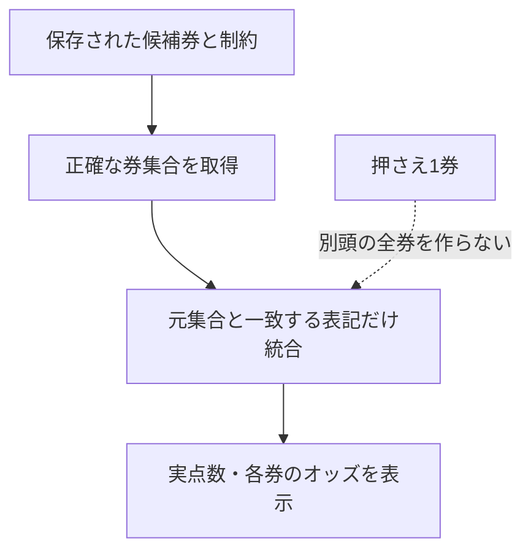

# 本命・フォーメーションの偏りの診断

2026-10-21に「本命がほぼ1-234-34、流しがほぼ1-234-23456」との報告を受け、mainと同じコード、合成入力、当日の保存原本3件を照合した。全レースの出現頻度や的中率の計測ではない。

## 相手が似る主因

`js/ai-core.js::buildHoldPickupTheory()` は、逃げ展開の2着候補を実コース2・3・4、3着候補を実コース3・4・5・6へ制限する。正式順位は展開との一致、実進入・位置関係、壁・経路、取得信頼度から決め、この段階ではST・展示・当地・技量・モーターを再加点しない。正式候補がある場合は、別のスコアから相手を補完しない。

同じ公式進入・escape・壁条件を与え、2・3・4艇と5・6艇の評価値の高低を逆転した合成比較では、2着順位2・4・3、3着順位3・4・5・6、本線先頭3券1-2-3／1-4-3／1-3-4、全12券の1-234-全が変わらなかった。実コース2の艇を替えると券も変わる。これは艇番そのものの固定と区別する。本線全6券の後半には5艇目も含まれ、全券が1-234-34になるとは断定しない。

本線候補の並びから `js/practical-selection.js` が通常枠の先頭3券を採る処理もある。主展開が同じなら相手の個別評価を変えても同じ券へ寄りやすく、ここを変更するには予想規則の候補比較が必要になる。単なる表示修正や配線漏れの修正とは扱わない。

本命頭は主展開と印に接続され、1号艇に固定されていない。上流ではST・展示等が展開や壁の判定へ使われるため、予想全体がそれらを無視するという意味ではない。

## 広いフォーメーションの仕様

正式な主展開の頭を固定し、正式2着候補最大3艇、3着は頭と各2着艇を除く全艇へ展開する。2着1〜3艇なら4・8・12点となる。頭1、2着234なら1-234-全で、同じ集合を1-234-23456と表せる。

この表示候補と実戦厳選の購入券は別契約。厳選が2券・0券でも、元の全点フォーメーションを表示する既存仕様を維持する。単に厳選だけへ縮めると承認済み表示契約が変わる。

## 今回修正する表示不具合

`js/formation-odds-display.js` は、主頭1・2着345の元12券と、頭2の押さえ1券があるだけで、12-345-全の24券へ広げていた。逆の主頭2と頭1の押さえでも同じ問題がある。これは典型的な1-234-全の固定化とは別の不具合である。

修正後は、各フォーメーションの明示券・頭・2着・3着制約を守る。疎な集合は正確な複数行へ分け、頭の異なる行は再展開が元券の和集合と一致する範囲だけでまとめる。押さえ・オッズ・実戦厳選から新しいフォーメーション券を作らない。元予想と購入対象は変更しない。もともと明示された12-345-全の24券や、通常4・8・12点は保持する。

同じ1着・2着の券を初めにまとめ、合法120券のような大きな集合でも無駄な1券単位の比較を減らす。性能の固定閾値を予想条件やテストの合否へ追加しない。loaderとHTMLのURL世代も更新し、旧キャッシュから修正後の表示へ到達させる。

## 保存原本の確認範囲

固定main `e944e0cb35db15356b28cd1812ee90e8e3f73938` の当日note原本から、転送量を抑えるため小さい3ファイルを選んだ。頻度推計用の無作為標本ではない。ファイルSHA256・Git blob SHA・サイズを照合し、原本を書き換えず結果とも結合していない。

原本: [唐津3R](https://github.com/takechanman12250711-oss/chappy-boatrace-ai/blob/e944e0cb35db15356b28cd1812ee90e8e3f73938/data/note-drafts/20261021/20261021-23-3-e9c312e812a25e77604244eb6fe3e592b528d379b20eedf68106bdeb81408213.json)、[鳴門4R](https://github.com/takechanman12250711-oss/chappy-boatrace-ai/blob/e944e0cb35db15356b28cd1812ee90e8e3f73938/data/note-drafts/20261021/20261021-14-4-8e216a49a05305fc0f6742bcd7d3f317108e3bdd9cc0daaef682d853de820373.json)、[浜名湖4R](https://github.com/takechanman12250711-oss/chappy-boatrace-ai/blob/e944e0cb35db15356b28cd1812ee90e8e3f73938/data/note-drafts/20261021/20261021-06-4-61d58c87886fcb696c35f6943d202ccb1b991c831cc1676e0e6f0c90a7a51ab1.json)。

| 保存原本 | 主展開 | 本命頭 | 保存本線候補 | 全点フォーメーション |
| --- | --- | --- | --- | --- |
| 2026-10-21 唐津3R | 3コース攻め | 3 | 3-1-5 / 3-2-5 / 3-1-6 / 3-2-6 | 3-12-全・8点 |
| 2026-10-21 鳴門4R | 3コース攻め | 3 | 同上 | 3-12-全・8点 |
| 2026-10-21 浜名湖4R | 3コース攻め | 3 | 同上 | 3-12-全・8点 |

後2件の全候補根拠は外側statusがinvalid-or-unavailableで、救済前snapshotはdiagnostic-only。入れ子を最終購入資格や比較成績へ読み替えない。古い唐津原本にはその追加根拠自体がない。これらはアプリ全利用の頻度や精度を証明しない。

## 予想改善の次工程

主展開内の2・3着順位の個別評価を変更する場合、根拠・順位・点数を固定した候補を現行と同一レース・同一点数で比較し、追加した的中と失った的中を両方確認する。既存の全候補根拠保存を使い、新しい保存器や固定100R待ちを追加しない。PR #1319/#1322は1・2着組の増加が3連単改善につながらず、#1336も改善なしで未採用。これらを改善済みと扱ったり、同じ案を条件を変えず再試験したりしない。

PR #1350の新head比較は頭の1券交換の前向き研究であり、今回の主展開内の相手順位を変えるPRではない。表示修正、順位ルールの研究、実レースでの精度改善をそれぞれ確認する。

検査: `node scripts/test-formation-odds-display.js`、`node scripts/test-prediction-runtime-loader.js`、`node scripts/test-late-prediction-presentation.js`、`node scripts/test-final-display-semantics.js`、`node scripts/test-prediction-transparency-ui-approved.js`、`node scripts/test-ai-core-formations.js`、`node scripts/check-charter.js`。
