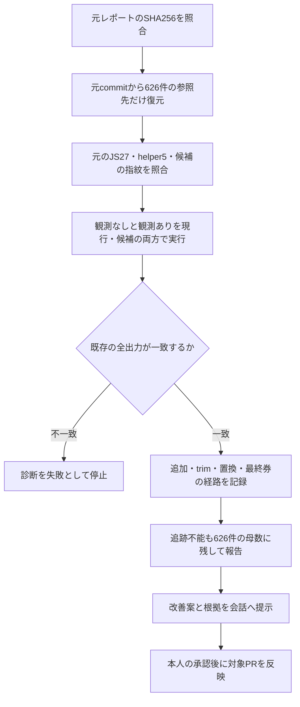

# 前回626件の選定経路診断

`qualified-unrepresented-head-one-swap-v1` の固定比較は626件すべてで最終券が変わらなかった。どの条件・段階で変更が止まるのかを調べる。候補の条件、優先順位、閾値、点数、保護条件は変えず、的中率の再集計もしない。

## 固定するもの

- 元run: `39377459439`、artifact: `12244097509`。
- 元レポートJSONのSHA256: `57e973ea28aabedcf9270e9c921e585e28bb988809861258f90a3aaca2aa3831`。
- 候補fingerprint: `c607ba387e1222048ec816cb6099a2e1f192df2c6226e4e9d7e3634175c49b8f`。
- 元入力commit: `92847c2b487568107084865cfc7df06270419ebe`。元レポートの各行にあるsourcePointerをそのまま使う。現時点のprimary優先再選択や、別index・別世代への差し替えはしない。

`run-independent-head-trace.cjs` はGitHub Actions上だけで原本を復元する。必要なのは15日分の日次原本と315件のnote原本で、公式結果・履歴の取得や全履歴のcheckoutは行わない。元commitのarchiveがある日付はgzipとmetadataのSHAを検証して1日ずつ復元する。gitの原本出力は直接ファイルへ流し、巨大JSONをコマンド出力へ載せない。

`trace-independent-head-coverage.cjs` が元record hashと保存予想を照合し、隔離VM内のsource変換だけで選定途中を観測する。研究用fieldを既存のexpansionSummaryに一時的に追加し、それを除いた全出力を観測なしの実行と照合する。候補本体と本番JSは編集しない。元の626件は、欠落・record変更・再現不能があっても診断の母数から落とさない。原本file hashが変わっていてrecord hashだけ同じ場合は区別して記録する。

候補へ研究用optionsが届いたかと、候補の条件ブロックが実行されたかを別に記録する。optionsが届かなかった場合を「資格のある候補なし」と混同しない。8段階の最後は内側selectorの最終券で、外側の既存救済処理が確定した公開APIの券は `publicFinalTickets` として別に照合する。

この診断は、選定経路を説明するための事後解析である。元の131件の再現不一致を修復したり、同じ評価期間で候補規則を調整したりしない。`productionChanged=false`、`automaticProductionChange=false`、`usableForPrediction=false` を維持する。診断で見つかった経路は改善仮説の材料とし、精度向上の証拠とは扱わない。

## 実行方法

既存の `Compare frozen escape predictions` を研究branchへ手動実行し、`independent_head_trace=true` を指定する。この入力を指定した実行では既存compare jobをskipし、読み取り専用の診断jobだけを動かす。既存cronと通常のcompare処理は従来どおり。診断jobはJSONを `independent-head-coverage-trace` artifactへ保存し、予想・結果・派生レポートを自動commitしない。

PRでは小fixtureだけを実行する。診断結果と検証をそろえ、PRと固定head、影響、図をこの会話へ提示する。今回のユーザー指定により、この会話での「承認」を受けてからAIが反映する。予想方式を本番採用する場合は、別途その変更内容と検証結果について承認を受ける。
