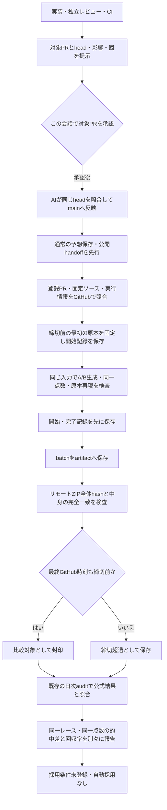

# 新head候補 v2 の締切前A/B記録

PR #1348で修正したselector optionsの受け渡しを使い、今後の保存原本から現行Aと独立候補Bを同時に生成する。候補は従来の「条件を満たす未収録headを1券だけ交換する」ルールを維持する。通常予想、note原稿、実購入成績は変更しない。

旧v1の626Rは受け渡し不成立の診断記録として保持する。v2への流用・再採点・候補採用の根拠にはしない。今回の変更は前向き比較の収集経路を追加するもので、的中率改善の実証ではない。

## 登録と変更検出

正本は `config/independent-head-forward-v2.json`。この変更を登録するPR番号を格納し、そのPRのGitHub `merged_at`を定義時刻にする。クライアントの任意時刻やGit commit時刻を定義証拠にしない。PRが未マージの間はcaptureできない。

captureは登録PRのマージcommitから設定の生bytes・blob SHAを照合する。登録されたGit treeの各source blobと現在のファイルも照合する。生成器、旧候補、VM依存、capture、artifact検証、live-note workflowをsource manifestへ固定する。sourceが変われば停止し、新しい登録が必要になる。データのみのmain更新は許容する。config自体の自己hash循環は作らず、GitHub上の登録済みconfig bytesで拘束する。

さらに実行中のGitHub runのrepository、main、workflow path、head、run ID、attempt、開始時刻、eventと実行状態を照合する。checkoutの固定ソースとconfigに未コミット変更がある場合も拒否する。

## 入力と中断の扱い

- 対象は当日の `data/note-drafts/YYYYMMDD/` にある不変原本。登録時刻以後に選択され、capture開始時点で締切前のものだけを候補にする。filenameのSHA256と実bytes、race ID、日付、選択時刻、締切を検査する。
- 時刻は実原本の `+09:00` を含む厳密なISO表記を受理し、epochで締切を比較する。原本・attempt・snapshotの表記やbytesは書き換えない。不正日・不正zone・zoneなし時刻は拒否し、締切と同時刻はclosed/lateとする。
- 同一Rは最も早い `selectedAt`、同時刻ならsource SHA256の順で固定する。一度開始したRは失敗・未完了でも後の原本へ差し替えない。
- 生成前にstartedを保存し、完了時はそのhashを参照するcompletedを追加保存する。途中停止は未完了として母数へ残す。生成失敗、入力不足、未封印、締切超過を的中・不的中に置き換えない。
- Aは元の実戦厳選の順序・head・展開を再現する必要がある。Bは同一点数で、元のmain head・main券・展開・旧headを保持し、条件を満たす新headの1券交換のみを認める。未変更の場合はA/B全体一致を要求する。
- plain/observedの4つの隔離VMで、受け渡したoptions、候補注入の実行、観測器を入れた前後の全出力一致を検査する。元の候補スクリプトとguardのbytesは変更しない。

## 締切前の保存証拠

started/completedをGit保存した後、同一runの `batch.json` 1個だけを `independent-head-v2-<runId>-<attempt>` artifactへ送る。seal時には元原本と永続記録を再照合し、GitHubからZIPをダウンロードする。metadata/uploadのdigestとZIP全体のSHA256、entry名・型・サイズ・CRC、展開後のbatch bytes完全一致を検査する。ファイルへのZIP展開はしない。

検証後に再取得したGitHub metadataのHTTP Dateに、秒精度の上限として1秒を加えた時刻を最終確認時刻にする。生成完了・最終確認の両方が締切前のgeneratedだけをeligibleとする。遅延、生成失敗、入力不足のreceiptも別状態で保存する。ダウンロードや照合に失敗すれば、保存済みの試行はunsealedのまま残る。

内部の `independent-head-forward-v2.cjs` は封印機能を持たない単一入力生成器であり、内部snapshotの `formalForwardEvidence=false` を維持する。締切前証拠の判定は外側のattemptと検証済みsealで行う。

## 実行範囲とレポート

既存live-noteの公開handoff、従来研究、公式ST保存の後に接続する。新cron、Work定期研究、有料APIは追加しない。1回最大6R・生成開始から20秒を目安とし、超過対象はdeferredとしてbatchに記録する。実行中の1Rは途中で打ち切らず、後続を繰り延べる。原本4MiB、artifact ZIP 8MiB、batch 4MiBを上限とする。全レースを必ず取り込める保証はなく、締切済み・不正原本・繰り延べも区別する。

既存日次auditで `scripts/head-forward-report.cjs` を実行し、派生レポートだけを `data/stats/independent-head-forward-v2-report.json` に書く。保存記録だけを読み、予想を再生成しない。startedを母数に未完了・失敗・未封印・遅延・結果待ち・不成立を示す。異なるprotocolの記録は未検証のアーカイブ件数として分離する。現protocolの不正記録やsource変更は正常0件に置き換えず、比較を停止する。

比較はeligibleかつ公式結果確定の同一R・同一点数に限定する。A/Bの的中数・率、増えた的中・失った的中・差引を示し、1券100円の投資・払戻・回収率は別に示す。結果待ちや返還を外れに数えない。固定100Rなどの新しい待機条件は設けず、`adoptionGate=null`、`usableForPrediction=false`、`automaticApplication=false`を維持する。

導入PRのfixture/CI成功と、main反映後の実レースcapture・締切前seal・比較成績は別に確認する。PR作成時点では実レースの収集成功や的中率改善を確認したとは扱わない。

検査: `node --test scripts/test-independent-head-forward-v2.cjs scripts/test-head-forward-contract.cjs scripts/test-head-forward-artifact.cjs scripts/test-head-forward-capture.cjs scripts/test-head-forward-report.cjs`。全て合成データを使い、通常予想や実履歴を書き換えない。
