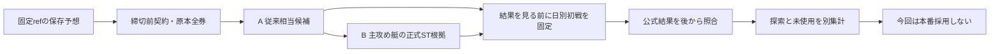

# コロがし初戦選定・正式ST根拠の検証 v1

2026-11-19、未使用期間の結果を取得する前に条件を固定。これは前回の探索で残った1仮説の研究であり、STの速さを判定する式ではない。

- 固定条件は `config/korogashi-first-race-st-v1.json`。Aは原本1〜7点かつ既存購入見送り以外、Bはその中で主攻め艇に対応する保存ST評価の `isFormal === true`。券・配分・STスコア閾値を変更しない。
- 探索11/10〜16と、前回分析で未使用の11/17〜18を別集計。11/17〜18は既に終了した期間であり、前向きの事前登録試験・封印済みholdoutとは呼ばない。既存封印研究を開かない。
- 固定refの保存予想とcomplete=trueの日次公式結果のみ。primary優先、同優先では最新保存。締切前契約を通し、generation別にも表示。欠測・未確定・返還等を0円負けにしない。
- 全候補の比較と、各日最初の候補を選ぶ研究上の比較を分ける。日別選択は結果結合前に固定し、最初の候補の結果が不明でも次レースへ置換しない。
- 保存予想には公開可用時刻・receipt・登録・掲載余裕の全証拠がない。この日別比較は締切順のproxyであり、本番の実初戦・連続コロがし成績ではない。Bが後刻まで待つことも未再現。
- 1点100円、原本全券。日別比較は共通日に対する総損益差と、選択なし・結果不明・同じ/違うレース数を示す。0件のROIはnull。
- 判断に必要な最低量はB100R・14日・両案の日別選択30組。同一generation・両半期の改善・100%超・最大払戻依存の確認も必要。これを満たしても前向き検証と本人の別承認なしに本番へ入れない。

`productionChanged=false / automaticApplication=false / usableForPrediction=false`。新cron・自動公開・有料API・既存原本の書換えを追加しない。結果と再実行手順は下へ追記する。

## 検証結果

元の探索期間299Rを同じrefで再計算し、前回のA48R・B14Rの全数値が一致した。未使用期間は75RからA8R・B3R。同一generation1種類、締切前判定落ち0、A/Bの結果不明0、ST欠測0・矛盾0。対象外の特別結果は集計へ入れず、日別初戦を差し替えない。

| 期間 | 群 | R | 的中 | 投入想定 | 払戻 | 回収率 |
| --- | --- | ---: | ---: | ---: | ---: | ---: |
| 探索11/10〜16 | A：従来相当の保存候補 | 48 | 15 | 31,300円 | 24,550円 | 78.43% |
| 探索11/10〜16 | B：主攻め艇の正式ST根拠あり | 14 | 5 | 9,300円 | 8,410円 | 90.43% |
| 未使用11/17〜18 | A | 8 | 2 | 5,400円 | 1,910円 | 35.37% |
| 未使用11/17〜18 | B | 3 | 1 | 2,100円 | 1,070円 | 50.95% |

全候補ではBの率がAより高いが、日別最初の1Rを選ぶ研究proxyでは異なる結果になった。

| 日 | A | B | B−Aの損益差 |
| --- | --- | --- | ---: |
| 11/17 | 唐津1R：600円→840円 | 江戸川9R：700円→0円 | −940円 |
| 11/18 | 常滑9R：700円→0円 | 同じ常滑9R | 0円 |

探索期間も共通6日の差は−7,880円で、残る11/12はB候補なし。全候補の率だけで初戦選択の良化としない。Bの最大払戻1件を除くと未使用期間の回収率は0%。11/17のBはAより低い回収率で、両日での改善は再現しなかった。

**判断：正式ST根拠があることだけを新しい初戦採用条件にする案は、今回本番へ採用しない。** B3R・2日・日別2組で固定した最低量にも届かず、収益と初戦比較の両方で十分な証拠がない。今回の結果を見てSTスコアの閾値を後付けしたり、8〜10点を7点に削ったりしない。本番の選定・券・配分は変更していない。

11/18の実運用は公開候補の点数条件により開始なしとClaudeが共有している。ここでの保存候補3件には、その時点で公開・照合可能な原稿だった証明がないので、本番なら選べたとは主張しない。

## 再実行と検査

```sh
node --expose-gc --max-old-space-size=3072 scripts/build-korogashi-first-race-st.cjs --out data/stats/korogashi-first-race-st-v1.json
node --test scripts/korogashi-first-race-st.test.cjs tests/continuous-performance-ledger.test.cjs
```

固定GitHub refから既存日次ファイル18本を逐次読み取り、入力path/ref/bytes/SHA256、protocol hash、使用実装のSHA256（UTF-8/LF正規化）を出力する。途中の取得失敗・completeでない結果は中止し、前回レポートを上書きしない。選定対象行と日別選定をJSONへ残す。取得した原本は書き換えない。

- 独立fixture16件＋既存台帳fixture1件が成功。原本/専用projectionの同値、結果を消す・勝券/払戻を変える・並べ替える場合の選定不変、最早候補の欠測保持、generation別初戦、正式flagの厳密型、特殊精算を確認。
- ledgerを呼ばないPowerShell別集計で、A/Bの件数・的中・投入・払戻・ROIと日別損益差が一致。
- `test-analysis-input-contract.js`の全履歴/保存参考レポート照合は、このsparse作業環境に対象データがないため完走していない。締切前条件と拒否flagは専用fixtureで確認。未変更の全履歴レポートを作り直さない。
- PR専用CIはfixtureだけで、実データ再取得・レポート自動更新・定期実行をしない。



関連：共有Issue #1460（条件固定コメント7005527380）、案内改善の既反映PR #1489。研究コードのmain反映は `docs/development-approval.md`、予想ロジックの採用は別の本人承認に従う。
