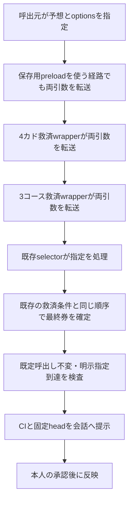

# 救済処理を通る選定optionsの引き継ぎ

PR #1347の固定診断は、元626件すべてで研究用 `researchBaselineHeads` が内側selectorへ届かず、候補の条件ブロックが一度も実行されていなかったことを確認した。診断runは `39433749162`、実行コードは `d45aa14f4936ee715a26bc9dd7b0057324c4a146`。この変更では、3コース救済・4カド救済・保存用 `frame-rise-fall-replay-preload` の3つのwrapperから `originalSelect(prediction, options)` へ第2引数を渡す。

## 作用する範囲

引数なし・`undefined`・空optionsの通常呼出しは、修正前後の全返却値が一致することを検査する。救済の適用条件、置換する券、順序、点数と、保存用の `frameRiseFallReplayBasis`・compactAuditは変更しない。`createPracticalSelection` の引数受付は変更しない。

明示指定では `researchBaselineHeads` に加え、既存の `escapeRolePartner=false/'replay'` も内側へ届く。`scripts/verify-escape-partner-paired.cjs` はこの明示指定を使うため、既定呼出し不変と区別して扱う。このPRでは同scriptによる過去成績の再比較を実行しない。新しいoptionsや予想条件は追加しない。

本番JSのsource hashは変わる。保存時の方式識別情報も別の版として扱い、既存の予想・結果・成績を修正後の方式へ付け替えない。

## 小fixtureとCI

`scripts/test-practical-selector-options.cjs` は、修正前wrapperを明示復元したsourceと修正版を別VMへ読み込む。通常、3コース救済、4カド救済、各救済券が既存、見送りの6経路について、引数なし・`undefined`・空optionsの18組を、救済2層のみ・保存preloadのbasisなし・basisありの3構成（計54組）で比較する。全返却値とcompactAuditの一致、個別・二重・3層のoptionsの同一参照・無変更、根拠情報の保持を検査する。

実selectorの合成fixtureでは、既存候補の条件ブロックへ指定が届き、同10券の1対1交換と既存guardが成立することを確認する。この合成fixtureを実レースの件数・的中結果へ加えない。

既存の両救済workflowを使い、4カド側へ新しい回帰検査と旧診断fixtureを接続する。必要なJS・scripts・configだけをcheckoutし、保存原本や全履歴を小fixtureのために展開しない。新しいworkflowやcronは作らない。

既存のWebKit段階診断も、2つのheadの実行（run `39444763665`・`39446165573`）がフルcheckoutのGit取得中に15分の制限へ達し、診断開始前に中断したため、checkoutをnon-cone sparseへ限定する。入口HTML・全JS/CSS・診断script・package.json・ホーム起動用の派生summaryだけを保持し、raw予想・note原本・archiveは展開しない。外部APIからの同じ入力、WebKit、core/createの診断内容、runtime一致・完了mark・終了コードによる成功判定と15分の制限は維持する。

## 元のv1診断を保持する

`test-independent-head-coverage-trace.cjs` は旧wrapperの正確なbytesを研究fixture内へ復元し、元SHA256の一致を必須とする。旧source manifest、候補fingerprint、元626件のreport、診断sidecar本体は変更しない。

本番wrapperが修正された現在のrootでは、旧診断の `verifyReferenceSources` はsource hash不一致で停止するのが正しい。旧診断を再現する場合は固定した実行コード `d45aa14` を使う。検査を緩めて修正後のコードを元v1として扱わない。

## 次の精度検証

この修正は指定を引き継ぐAPIの修復であり、候補の精度改善・本番採用を示すものではない。元v1と元626件は原因診断用に保持する。

次の候補は別ID・定義時刻・全source manifest・指紋を固定し、未使用期間に現行Aと候補Bを同じ締切前入力から生成する。両最終券、入力hash、候補指紋、guard、生成完了・保存時刻を締切前に保存してから、同レース・各R同点数で追加的中／失った的中／純増を評価する。現行candidate24表示poolや現行選抜のcaptureを候補Bの保存とみなさない。未生成・保存失敗は欠測のまま残す。このPRにはv2の生成・保存・採用gateを含めない。

接続先は既存live-noteの収集・公開handoff後の処理とする。既存 `partner-forward.cjs` は頭別配分の完全一致と別の固定selector SHAを要求し、新しい頭を増やす候補はその契約へ追加できない。既存のartifact保存・締切前確認の構成を参考に、v2専用のsnapshot・protocol・receipt verifierと保存先allowlistが必要である。旧partner契約を緩めたり、新collectorやcronを追加したりして代用しない。
