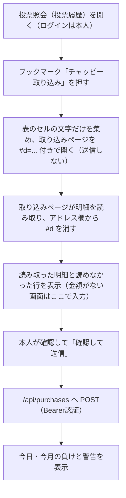

# 購入の取り込み（1タップ方式）

更新日: 2026-10-23

BOAT RACE公式サイトの投票照会（またはテレボートの投票履歴）の画面から、ブックマークを1回押すだけで購入明細を読み取り、購入同期API（chappy-boatrace-api `/api/purchases`）へ送る。送信後に購入の歯止め（日の負け上限1万円・月の予算5万円・1点500〜1,000円、警告のみ）を表示する。

- ページ: `purchase-import.html`（GitHub Pages）
- 読み取り: `js/teleboat-history-parser.js`
- 画面: `js/purchase-import.js`
- 検査: `node scripts/test-purchase-import.cjs`

## 流れ

## 安全性

- テレボートの加入者番号・暗証番号・パスワードはどこにも保存しない（`docs/PURCHASE_SYNC.md` の安全方針どおり）。ログインは本人が通常どおり行う。
- ブックマークは画面の文字を読むだけで、どこにも送信しない。読み取った内容はアドレスの `#` より後ろで渡すため、サーバーには届かない。
- 送信は取り込みページで本人が確認してから行う。送るのは読み取った明細（日付・場・レース・買い目・金額）だけ。
- 同期用トークンは本人が入力する。「この端末に保存する」を選んだときだけ、その端末のブラウザに保存する。チャット・PR・コミットには貼らない。
- APIは許可した配信元（`https://takechanman12250711-oss.github.io`）だけにCORSを許可する（chappy-boatrace-api 側の設定）。
- 自動購入・定期取得・サーバーからのテレボートへのアクセスはしない。

## 読み取りの規則

- 対象は3連単だけ。「場名」「nR（1〜12）」「a-b-c（3艇が異なる）」がそろう明細を1件の購入とする。1件が表の2行（場・レースの行と、式別・組番の行）に分かれる画面にも対応する。
- 日付は明細の行 → 画面上部の照会日（「2026年10月20日」や年・月・日の選択欄）の順に読む。どちらもなければ、読み取った日（日本時間）を「推定」と表示して使う。
- 金額は明細の行にあれば読む。BOAT RACE公式の投票照会の一覧には金額がないため、取り込みページで1件ずつ、または「空欄に入れる」でまとめて入力する。100円単位でない金額は送らない。
- 1行に複数の買い目がある行（フォーメーション・ボックス等）、3連単以外、場名・レース番号・金額が読めない行は推測で埋めず、「読めなかった行」として表示して送らない。
- 同じ画面を取り込み直しても重複しないよう、明細IDは日付・場・レース・買い目・金額と、同じ内容の何件目かから作る。

## 未確認・既知の限界

- **画面の作りは、2026-10-20のBOAT RACE公式の投票照会（スマホ表示）をPDF化したもので確認した。** PDFでは日本語の文字が取り出せないため、場名などの文字・表の行の分かれ方（HTMLの構造）は推定。実際の画面で読めない行が出たら、読み取り処理（アプリ側）を直す。ブックマークの登録し直しは不要。
- 投票照会の各明細の詳細画面（金額・払戻がある想定）は未確認。詳細まで自動で読めれば金額の入力が不要になる。
- テレボート側のセキュリティ設定（CSP）がブックマーク自体の実行を止める場合は動かない。Chromiumの検証では、送信先を制限した画面でも取り込みページを開けることを確認したが、iPhoneのSafariと実際のテレボートでは未確認。
- 1行に1点の金額と払戻金の両方がある画面では、最初の金額を購入額とみなす。画面の確認で合わせる。
