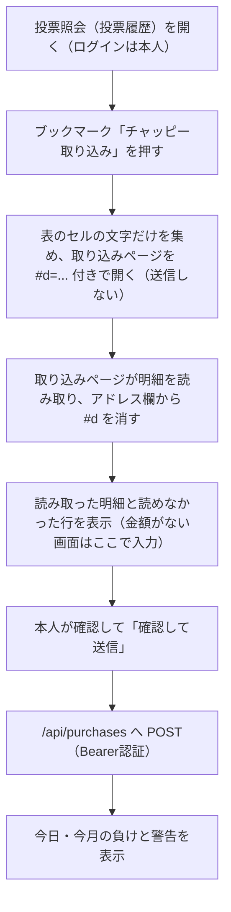

# 購入の取り込み（1タップ方式）

更新日: 2026-10-23

BOAT RACE公式サイトの投票照会（またはテレボートの投票履歴）の画面から、ブックマークを1回押すだけで購入明細を読み取り、購入同期API（chappy-boatrace-api `/api/purchases`）へ送る。送信後に購入の歯止め（日の負け上限1万円・月の予算5万円・1点500〜1,000円、警告のみ）を表示する。

- ページ: `purchase-import.html`（GitHub Pages）
- 読み取り: `js/teleboat-history-parser.js`
- 画面: `js/purchase-import.js`
- 検査: `node scripts/test-purchase-import.cjs`

## 流れ

## 安全性

- テレボートの加入者番号・暗証番号・パスワードはどこにも保存しない（`docs/PURCHASE_SYNC.md` の安全方針どおり）。ログインは本人が通常どおり行う。
- ブックマークは画面の文字を読み、明細の No を押して詳細を開き・閉じるだけで、どこにも送信しない（投票などの操作はしない）。読み取った内容はアドレスの `#` より後ろで渡すため、サーバーには届かない。
- 送信は取り込みページで本人が確認してから行う。送るのは読み取った明細（日付・場・レース・買い目・金額）だけ。
- 同期用トークンは本人が入力するか、取り込みページの「合言葉を作る」で端末の中だけで作る（`crypto.getRandomValues` の32バイト、43文字）。ふだんは作らず、Vercel に設定済みの値を貼り付けて使う。この値は GitHub Actions（`settle-purchases.yml` の5分ごとの精算と最終オッズ収集、`verify-purchase-production.yml`）でも Secret として使っているため、新しく作った場合は Vercel の環境変数と GitHub の Secret の両方を同じ値に置き換え、Vercel をデプロイし直す。片方だけを変えると自動精算が401で止まる。「この端末に保存する」を選んだときだけ、その端末のブラウザに保存する。チャット・PR・コミットには貼らない。
- APIは許可した配信元（`https://takechanman12250711-oss.github.io`）だけにCORSを許可する（chappy-boatrace-api 側の設定）。
- 自動購入・定期取得・サーバーからのテレボートへのアクセスはしない。

## 読み取りの規則

- 対象は3連単だけ。「場名」「nR（1〜12）」「a-b-c（3艇が異なる）」がそろう明細を1件の購入とする。1件が表の2行（場・レースの行と、式別・組番の行）に分かれる画面にも対応する。
- 日付は明細の行 → 画面上部の照会日（「2026年10月20日」や年・月・日の選択欄）の順に読む。どちらもなければ、読み取った日（日本時間）を「推定」と表示して使う。
- 金額は明細の行にあれば読む。BOAT RACE公式の投票照会の一覧には金額がないため、ブックマークが各明細の No を順に押して詳細の小窓（購入金額・払戻金）を開き、金額を読んでから閉じる（2026-10-20 No 001 の小窓のPDFで項目を確認）。通し番号と組番が一致した詳細の金額だけを使う。小窓が2秒以内に出なければ詳細の読み取りをやめる。
- 読めなかった金額は、取り込みページで1件ずつ、または「空欄に入れる」でまとめて入力する。100円単位でない金額は送らない。
- 投票照会の「合計」タブでブックマークを押すと、その日の購入金額・払戻金額・レース数を表示し、「この合計を送信」で購入同期APIの `dailySummaries` に記録する。1日の負けと月の予算はこの合計で判定する（chappy-boatrace-api #49 で対応済み）。同じ値をこの端末のブラウザにも覚え（直近31日分）、同じ日の明細を送るときにも一緒に送る。同じ日の一覧を取り込むと、入力した金額の合計と照会の購入金額を並べて表示する（2026-10-20の「合計」タブのPDFで項目を確認）。
- 1行に複数の買い目がある行（フォーメーション・ボックス等）、3連単以外、場名・レース番号・金額が読めない行は推測で埋めず、「読めなかった行」として表示して送らない。
- 明細IDは日付・場・レース・買い目と、投票照会の通し番号（No 001〜）から作る。同じ画面を取り込み直しても重複せず、別の画面・絞り込みで取り込んでも別の購入が同じIDにならない。金額はIDに含めないので、直して送り直すと同じ明細が更新される。
- 通し番号がない画面では、同じ画面の中で同じ内容の何件目かで区別する。この場合、別の画面にまたがる同じ券の別の購入は区別できない。

## マイページの収支（いちばん簡単な使い方）

- マイページ「今月の収支」→「日別合計」のタブでブックマークを押すと、その月の日ごとの購入金額・払戻（購入も払戻もない日は除く）を `dailySummaries` としてまとめて送れる。1日の負けと月の予算はこの数字で判定する（`parseDailyTotals`）。
- その日の投票結果の「収支合計」のタブでも、その日の分を送れる（`parseSummary`）。
- 月別・年別収支の「収支合計」は1日の合計ではないので使わない。年別収支は記録に使わない。
- 月は見出し「2026年 10月 月別収支」→ 選択中の月の順に読む（画面の文字には選択欄の全候補が入るため）。
- マイページは当日の結果を反映しない。当日分は翌日以降に送る。
- 明細を読む方式（投票照会の一覧）は残すが、実画面では0件になった（原因未確認。0件のときは「0件のときの確認用」で読み取った中身を表示する）。

## 未確認・既知の限界

- **画面の作りは、2026-10-20のBOAT RACE公式の投票照会（スマホ表示）をPDF化したもので確認した。** PDFでは日本語の文字が取り出せないため、場名などの文字・表の行の分かれ方（HTMLの構造）は推定。実際の画面で読めない行が出たら、読み取り処理（アプリ側）を直す。ブックマークの登録し直しは不要。
- 詳細の小窓の開き方・閉じ方（HTMLの構造）は、PDFからの推定。実際の画面で小窓が開かない・閉じない場合は、金額の手入力に戻る。
- テレボート側のセキュリティ設定（CSP）がブックマーク自体の実行を止める場合は動かない。Chromiumの検証では、送信先を制限した画面でも取り込みページを開けることを確認したが、iPhoneのSafariと実際のテレボートでは未確認。
- 1行に1点の金額と払戻金の両方がある画面では、最初の金額を購入額とみなす。画面の確認で合わせる。
