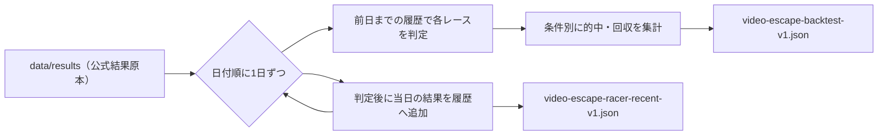

# 外部動画のイン逃げ選定ルール 検証 v1

更新日: 2026-10-21

## 位置づけ

YouTube「初心者でも的中率8割を狙う3連単の買い方とレースの選び方」（フナフェッショナル／あべけん、2026-10-20公開、https://www.youtube.com/watch?v=MbNrZ4cx3aQ ）のレース選定ルールを、既存の公式結果原本だけで再現した**研究集計**。`chappy-source-research` の扱いに従い、外部理論は補助仮説として検証するだけで本番へ入れない。

- `productionChanged=false` / `automaticApplication=false` / `usableForPrediction=false`
- 新しい外部サイト収集・cron・有料APIは追加しない。入力は既存の `data/results/*.json`
- ルールの出典は、ユーザーがGeminiで作成した動画要約（動画本体は未視聴）

## 何を作ったか

| ファイル | 内容 |
| --- | --- |
| `scripts/video-escape-filter.cjs` | 枠別過去10走・コース別ST・フィルタ判定・返還込みの精算・当日展示判定・最低オッズ判定の純粋関数 |
| `scripts/build-video-escape-backtest.cjs` | 結果原本を日付順に読み、条件別・年別の成績とスナップショットを出力 |
| `data/stats/video-escape-backtest-v1.json` | 検証結果 |
| `data/stats/video-escape-racer-recent-v1.json` | 最新結果日時点の選手別「枠別直近10走の着順」「実進入コース別の直近10回ST」（直近365日に完走記録がある選手） |
| `scripts/test-video-escape-filter.cjs` | fixture検査 |

再生成: `node scripts/build-video-escape-backtest.cjs`（約6秒）

## 判定ルール

| 区分 | 条件 |
| --- | --- |
| filter1 | 1号艇の選手が1枠の直近10走で1着7回以上、2〜6号艇の選手が各自の枠の直近10走で1着3回以下（6艇すべての選手が分かるレースだけ） |
| filter12 | filter1 かつ 6艇すべての平均ST（直近10回、F・出遅れ除く、3回以上）がそろい、1号艇の1コース平均STが他5艇の各自コース平均ST以下（枠なり前提） |
| filter12wall | filter12 かつ 2・3号艇の平均STが1号艇+0.03秒以内（動画に数値がなく仮置き） |

買い目は動画の 12点（1-234-全）と 4点（1-23-234）。1点100円。

## 結果（2024-01-01〜2026-10-20の収集完了日、前日までの情報だけで判定）

| 区分 | レース数 | 1号艇1着 | 12点 的中 | 12点 回収 | 12点 的中のうちトリガミ | 4点 的中 | 4点 回収 |
| --- | ---: | ---: | ---: | ---: | ---: | ---: | ---: |
| 全レース | 116,290 | 54.9% | 44.8% | 73.2% | 46.5% | 22.2% | 76.4% |
| filter1 | 30,645 | 68.9% | 56.6% | 74.0% | 54.2% | 28.4% | 78.7% |
| filter12 | 11,792 | 72.2% | 59.6% | 74.1% | 56.8% | 30.6% | 81.4% |
| filter12wall | 1,831 | 71.1% | 59.9% | 74.0% | 57.8% | 32.2% | 80.1% |

年別（2024・2025・2026）でもどの区分も回収率は70〜85%で、100%を超えた年はない。

2026-10-21 Codexレビュー対応で判定を修正した（修正前はfilter1 44,559R・filter12 17,952R・filter12wall 2,720R、全レース151,048R）。①完走しなかった2〜6号艇がいるレースを「弱い相手」として通過させず判定対象外にした。②5艇すべての平均STがそろわないレースでは「1号艇が最速」と判定しないようにした。③2〜6号艇が自分の枠で10走そろわないレースを判定対象外にした。④収集途中（`complete: false`）の237日を判定・集計から外した（確定済みレースは履歴にだけ積む）。結論（回収率は100%に届かない）は変わらない。

### 読み取り

1. **動画の2着分布は再現した**。1号艇1着時の2着は2号艇33.7%・3号艇28.6%・4号艇18.8%で計81.1%（動画は35.0/27.4/18.4%）。
2. **フィルタは的中率を上げるが、回収率はほぼ上がらない**。1号艇1着率は54.9%→72.2%に上がる一方、12点の回収率は73.2%→74.1%。強いイン艇は市場がすでに低オッズで評価している。
3. **的中率8割には届かない**。最も絞ったfilter12wallでも12点で59.9%。
4. **12点買いは的中の半分以上がトリガミ**。動画の最低オッズ見送りが効く余地はここにあるが、締切前の全120通りオッズが原本にないため、今回は検証できていない。
5. 4点買いはどの区分でも12点より回収率が高いが、100%には届かない。

## 未検証・既知の偏り

- ③当日展示（展示ST・展示タイム）と最低オッズ見送りは、結果原本に含まれないため未検証。`evaluateExhibition` と `evaluateOdds` は当日のAPI応答（`/api/race` の `startExhibition`・`entries[].exhibition.displayTime`、`/api/odds`）に使える形だが、閾値は仮置き。展示は公式のスタート展示画像から読めた進入（`isOfficialCourse: true`）が6艇分そろい、全艇が枠なり進入のときだけ判定する。展示で出遅れ（L）の艇がいれば判定しない。
- 完走しなかった選手は結果原本に登録番号がないため、その走は履歴に入らない。完走しなかった2〜6号艇がいる6,406Rは選手不明として判定対象外（other-boat-unknown）。この除外も完走の有無というレース後の情報に依存するため、選手を締切前に確定できる入力（保存予想は2026-07-22〜）での確認が残る。
- 1号艇が完走しなかった1,509Rは選手不明で判定対象外（うちF・出遅れ・欠場による返還905R、転覆等604R）。
- 2〜6号艇のいずれかが自分の枠で10走そろわない7,009Rは判定対象外。
- 収集途中（`complete: false`）の237日は判定・集計せず、確定済みレースは履歴にだけ積む。2025年3月は結果原本がなく、その間の走は履歴にない（直近10走が1か月以上前の走を含むことがある）。
- 展示ST・展示タイムの閾値比較は0.01秒単位の整数で行い、ちょうど0.05秒の差も「へこみ」「伸び」とする。
- フライング・出遅れ・欠場艇を含む券は返還として購入額・払戻から除外。

## 次に検証できること

- 既存の最終オッズ収集（API側、保持60日）を使い、最低オッズ見送りを前向きに保存・照合する
- 既存の予想原本にある直前情報で③の閾値を検証する
- 採用判断は、十分な前向きサンプルで回収率を示したうえでユーザー承認後に別PRで行う
